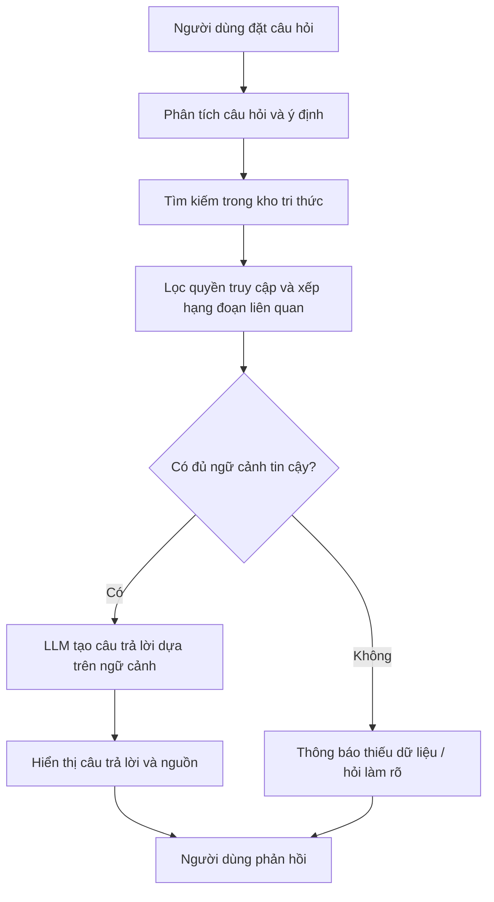
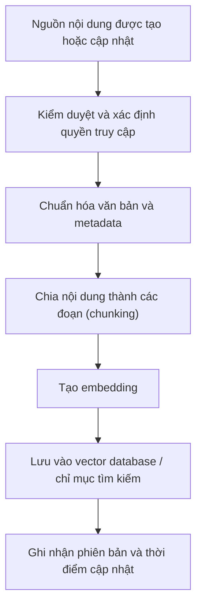

# PHÂN TÍCH NGHIỆP VỤ CHỨC NĂNG ĐỀ TÀI LOCALCRAFT

**Tên đề tài:** Xây dựng nền tảng kết nối nghệ nhân và khách du lịch thông qua sản phẩm và trải nghiệm thủ công địa phương, tích hợp AI hỗ trợ đề xuất – LocalCraft.

## 1. Tổng quan nghiệp vụ

### 1.1. Mô tả hệ thống

LocalCraft là nền tảng số giúp kết nối nghệ nhân, cơ sở sản xuất thủ công địa phương với khách du lịch thông qua việc giới thiệu sản phẩm thủ công, khám phá làng nghề và đặt các hoạt động trải nghiệm như làm gốm, dệt vải, làm nón, chế tác đồ lưu niệm hoặc tham gia workshop thủ công.

Hệ thống cho phép nghệ nhân quản lý thông tin cá nhân, sản phẩm, lịch tổ chức workshop và các đơn đặt hàng. Khách du lịch có thể tìm kiếm, khám phá, đặt lịch trải nghiệm, mua sản phẩm và đánh giá chất lượng dịch vụ. Đồng thời, hệ thống tích hợp AI Recommendation nhằm phân tích nhu cầu, sở thích và ngân sách của khách để đề xuất sản phẩm hoặc trải nghiệm phù hợp.

**Định hướng nghiệp vụ:** LocalCraft không chỉ là một sàn thương mại điện tử mà còn là nền tảng khám phá văn hóa, quảng bá làng nghề và kết nối khách du lịch với nghệ nhân thông qua những trải nghiệm thủ công thực tế.

### 1.2. Mục tiêu nghiệp vụ

- **Đối với nghệ nhân:** Số hóa hoạt động giới thiệu sản phẩm, quảng bá làng nghề, quản lý workshop, đơn hàng và lịch đặt chỗ.
- **Đối với khách du lịch:** Dễ dàng tìm hiểu văn hóa địa phương, khám phá sản phẩm, lựa chọn trải nghiệm và thực hiện giao dịch trực tuyến.
- **Đối với quản trị viên:** Quản lý người dùng, kiểm duyệt nội dung, giám sát giao dịch và thống kê hoạt động toàn hệ thống.
- **Đối với hệ thống AI:** Cá nhân hóa việc khám phá và đề xuất sản phẩm, nghệ nhân, workshop theo nhu cầu của từng khách hàng.

### 1.3. Đối tượng sử dụng

<box border radius="xl" padding={3} gap={3}>
  <row align=start gap={3}>
    <box background="#E0F2FE" radius="lg" size="44px" align=center justify=center>
      <icon name="user-round" color="#0369A1" size="xl"/>
    </box>
    <box flex="1" gap={1}>
      **1. Khách du lịch (Tourist)**

      <text color="secondary" size="sm">Tìm kiếm, khám phá sản phẩm và làng nghề, đặt workshop, mua hàng, thanh toán, quản lý đặt chỗ và đánh giá.</text>
    </box>
  </row>
  <divider color="subtle"/>
  <row align=start gap={3}>
    <box background="#D1FAE5" radius="lg" size="44px" align=center justify=center>
      <icon name="palette" color="#047857" size="xl"/>
    </box>
    <box flex="1" gap={1}>
      **2. Nghệ nhân (Artisan)**

      <text color="secondary" size="sm">Quản lý hồ sơ, giới thiệu làng nghề, đăng sản phẩm, tạo workshop, quản lý lịch, đơn hàng và lượt đặt chỗ.</text>
    </box>
  </row>
  <divider color="subtle"/>
  <row align=start gap={3}>
    <box background="#F3E8FF" radius="lg" size="44px" align=center justify=center>
      <icon name="shield-check" color="#7E22CE" size="xl"/>
    </box>
    <box flex="1" gap={1}>
      **3. Quản trị viên (Admin)**

      <text color="secondary" size="sm">Quản lý tài khoản, xác minh nghệ nhân, kiểm duyệt nội dung, giám sát giao dịch, xử lý báo cáo và theo dõi thống kê.</text>
    </box>
  </row>
  <divider color="subtle"/>
  <row align=start gap={3}>
    <box background="#FEF3C7" radius="lg" size="44px" align=center justify=center>
      <icon name="brain-circuit" color="#B45309" size="xl"/>
    </box>
    <box flex="1" gap={1}>
      **4. Dịch vụ AI Recommendation**

      <text color="secondary" size="sm">Phân tích tiêu chí tìm kiếm, ngân sách, sở thích và hành vi tương tác để đề xuất nội dung phù hợp. Đây là thành phần hỗ trợ của hệ thống, không phải vai trò đăng nhập độc lập.</text>
    </box>
  </row>
</box>

## 2. Phân tích nghiệp vụ tổng thể

LocalCraft được chia thành 10 phân hệ chức năng chính:

| Mã | Phân hệ | Chức năng nghiệp vụ |
|---|---|---|
| F01 | Quản lý tài khoản | Đăng ký, đăng nhập, hồ sơ, phân quyền |
| F02 | Quản lý nghệ nhân và làng nghề | Hồ sơ nghệ nhân, thông tin làng nghề, câu chuyện văn hóa |
| F03 | Quản lý sản phẩm thủ công | Đăng sản phẩm, cập nhật thông tin, tồn kho |
| F04 | Khám phá và tìm kiếm | Tìm kiếm, lọc, bản đồ, xem chi tiết |
| F05 | Quản lý workshop và trải nghiệm | Tạo hoạt động, lịch, sức chứa, giá vé |
| F06 | Đặt chỗ và quản lý booking | Đặt workshop, thanh toán, hủy, hoàn tiền theo chính sách |
| F07 | Đơn hàng và mua sản phẩm | Giỏ hàng, đặt mua, vận chuyển, theo dõi đơn |
| F08 | Đánh giá và tương tác | Đánh giá, bình luận, yêu thích, báo cáo nội dung |
| F09 | AI Recommendation | Đề xuất sản phẩm, workshop và nghệ nhân |
| F10 | Quản trị và báo cáo | Kiểm duyệt, quản lý giao dịch, thống kê và cấu hình |

Ngoài các phân hệ trên, hệ thống cần có chức năng thông báo và quản lý chính sách để hỗ trợ các quy trình xuyên suốt.

## 3. Phân tích chức năng chi tiết theo từng phân hệ

## 3.1. F01 – Quản lý tài khoản và phân quyền

**Mục đích:** Quản lý danh tính, thông tin cá nhân và quyền truy cập của người dùng.

| Mã | Chức năng | Mô tả nghiệp vụ |
|---|---|---|
| F01.01 | Đăng ký tài khoản | Người dùng đăng ký bằng email, mật khẩu và thông tin cơ bản. |
| F01.02 | Đăng nhập | Xác thực thông tin tài khoản và cấp quyền truy cập tương ứng. |
| F01.03 | Đăng xuất | Kết thúc phiên đăng nhập hiện tại. |
| F01.04 | Quên mật khẩu | Gửi liên kết hoặc mã xác minh để đặt lại mật khẩu. |
| F01.05 | Quản lý hồ sơ | Cập nhật họ tên, ảnh đại diện, số điện thoại, ngôn ngữ và thông tin liên hệ. |
| F01.06 | Đăng ký trở thành nghệ nhân | Người dùng gửi thông tin nghề nghiệp, địa điểm hoạt động và minh chứng liên quan. |
| F01.07 | Quản lý trạng thái tài khoản | Theo dõi trạng thái chờ xác minh, hoạt động, bị khóa hoặc từ chối. |
| F01.08 | Phân quyền | Phân biệt quyền của khách du lịch, nghệ nhân và quản trị viên. |
| F01.09 | Lịch sử hoạt động | Lưu các hoạt động quan trọng như cập nhật hồ sơ, tạo sản phẩm và đặt chỗ. |

**Quy tắc nghiệp vụ:**

- Email phải là duy nhất trong hệ thống.
- Người đăng ký làm nghệ nhân chỉ được sử dụng các chức năng quản lý dành cho nghệ nhân sau khi được phê duyệt.
- Tài khoản bị khóa không được thực hiện các giao dịch mới.
- Người dùng chỉ được sửa thông tin thuộc quyền sở hữu của mình, trừ trường hợp quản trị viên được cấp quyền xử lý.
- Mật khẩu phải được lưu dưới dạng băm an toàn, không lưu trực tiếp dưới dạng văn bản.

## 3.2. F02 – Quản lý hồ sơ nghệ nhân và làng nghề

**Mục đích:** Số hóa thông tin nghệ nhân, cơ sở sản xuất và giá trị văn hóa của các làng nghề địa phương.

| Mã | Chức năng | Mô tả nghiệp vụ |
|---|---|---|
| F02.01 | Tạo hồ sơ nghệ nhân | Khai báo tên, ảnh, nghề thủ công, kinh nghiệm và thông tin liên hệ. |
| F02.02 | Cập nhật hồ sơ | Chỉnh sửa thông tin cá nhân và nghề nghiệp. |
| F02.03 | Quản lý cơ sở/làng nghề | Khai báo tên, địa chỉ, tọa độ, hình ảnh và mô tả địa điểm. |
| F02.04 | Giới thiệu nghệ nhân | Hiển thị hồ sơ, chuyên môn, thành tựu và các hoạt động đang cung cấp. |
| F02.05 | Kể chuyện văn hóa | Đăng bài giới thiệu lịch sử, nguồn gốc, kỹ thuật và giá trị của nghề thủ công. |
| F02.06 | Quản lý hình ảnh | Thêm, sửa, xóa ảnh về nghệ nhân, quy trình sản xuất và không gian làng nghề. |
| F02.07 | Quản lý trạng thái hiển thị | Lưu nháp, gửi duyệt, công khai hoặc ẩn hồ sơ và bài viết. |
| F02.08 | Xem thống kê hồ sơ | Theo dõi lượt xem hồ sơ và mức độ quan tâm của khách du lịch. |

**Quy tắc nghiệp vụ:**

- Mỗi hồ sơ nghệ nhân có một tài khoản quản lý chính.
- Một làng nghề có thể có nhiều nghệ nhân và cơ sở sản xuất.
- Nội dung công khai cần tuân thủ quy định kiểm duyệt của nền tảng.
- Thông tin địa điểm nên có địa chỉ và tọa độ để phục vụ tìm kiếm trên bản đồ.
- Cần phân biệt nội dung giới thiệu văn hóa với thông tin bán hàng để giữ đúng định hướng quảng bá làng nghề.

## 3.3. F03 – Quản lý sản phẩm thủ công

**Mục đích:** Hỗ trợ nghệ nhân giới thiệu và quản lý các sản phẩm thủ công, từ thông tin sản phẩm đến tình trạng hàng hóa.

| Mã | Chức năng | Mô tả nghiệp vụ |
|---|---|---|
| F03.01 | Thêm sản phẩm | Nhập tên, mô tả, giá bán, hình ảnh và loại sản phẩm. |
| F03.02 | Cập nhật sản phẩm | Chỉnh sửa thông tin, giá bán và hình ảnh. |
| F03.03 | Phân loại sản phẩm | Phân loại theo nghề thủ công, chất liệu, địa phương và mục đích sử dụng. |
| F03.04 | Quản lý tồn kho | Theo dõi số lượng còn lại và cập nhật tồn kho khi phát sinh giao dịch. |
| F03.05 | Quản lý trạng thái | Lưu nháp, chờ duyệt, đang bán, hết hàng, tạm ẩn hoặc bị từ chối. |
| F03.06 | Quản lý nguồn gốc | Ghi nhận nghệ nhân, cơ sở sản xuất, làng nghề và câu chuyện sản phẩm. |
| F03.07 | Xem thống kê sản phẩm | Theo dõi lượt xem, lượt yêu thích, số đơn và doanh thu. |
| F03.08 | Quản lý biến thể | Quản lý kích thước, màu sắc hoặc mẫu mã nếu sản phẩm có nhiều lựa chọn. |

**Thông tin sản phẩm cần quản lý:**

- Tên và mã sản phẩm.
- Danh mục, mô tả và hình ảnh.
- Giá bán, số lượng tồn kho.
- Nghệ nhân hoặc cơ sở sản xuất sở hữu sản phẩm.
- Làng nghề và địa điểm xuất xứ.
- Thời gian chuẩn bị hàng, kích thước và khối lượng nếu cần vận chuyển.
- Trạng thái kiểm duyệt và trạng thái kinh doanh.

**Quy tắc nghiệp vụ:**

1. Chỉ nghệ nhân có quyền quản lý sản phẩm của mình.
2. Sản phẩm phải có giá bán hợp lệ, mô tả cơ bản và hình ảnh theo quy định trước khi gửi duyệt.
3. Sản phẩm bị từ chối không được hiển thị công khai.
4. Không cho phép đặt mua vượt quá số lượng có thể cung cấp.
5. Khi đơn hàng được xác nhận, hệ thống cần giữ hoặc trừ tồn kho theo quy trình giao dịch đã thiết kế.
6. Thông tin giá và tên sản phẩm tại thời điểm đặt hàng phải được lưu trong chi tiết đơn hàng để bảo toàn lịch sử giao dịch.

## 3.4. F04 – Khám phá, tìm kiếm và bản đồ làng nghề

**Mục đích:** Giúp khách du lịch khám phá không chỉ sản phẩm mà còn cả nghệ nhân, làng nghề và những hoạt động văn hóa liên quan.

| Mã | Chức năng | Mô tả nghiệp vụ |
|---|---|---|
| F04.01 | Trang chủ khám phá | Hiển thị làng nghề nổi bật, sản phẩm, workshop và nội dung văn hóa. |
| F04.02 | Tìm kiếm tổng hợp | Tìm kiếm theo từ khóa sản phẩm, nghệ nhân, làng nghề hoặc workshop. |
| F04.03 | Lọc sản phẩm | Lọc theo giá, danh mục, chất liệu, địa điểm và đánh giá. |
| F04.04 | Lọc workshop | Lọc theo ngày, giờ, giá, loại trải nghiệm, địa điểm và số chỗ còn lại. |
| F04.05 | Khám phá theo địa phương | Tìm nội dung theo tỉnh, thành phố hoặc khu vực. |
| F04.06 | Bản đồ làng nghề | Hiển thị vị trí nghệ nhân, cơ sở sản xuất và địa điểm tổ chức workshop. |
| F04.07 | Xem chi tiết | Xem mô tả, ảnh, giá, thông tin nghệ nhân, lịch hoặc tình trạng sản phẩm. |
| F04.08 | Danh sách yêu thích | Lưu sản phẩm, nghệ nhân và workshop muốn xem lại. |
| F04.09 | Nội dung liên quan | Gợi ý những nội dung cùng làng nghề, chất liệu hoặc chủ đề văn hóa. |
| F04.10 | Lịch sử khám phá | Lưu các lượt xem và tương tác cần thiết để cá nhân hóa đề xuất khi người dùng cho phép. |

**Quy tắc nghiệp vụ:**

- Chỉ hiển thị nội dung công khai và được phép truy cập.
- Kết quả tìm kiếm phải phản ánh trạng thái mới nhất của sản phẩm, lịch workshop và sức chứa.
- Có thể cho phép người chưa đăng nhập khám phá nội dung; yêu cầu đăng nhập khi thực hiện giao dịch hoặc chức năng cá nhân.
- Bản đồ chỉ hiển thị địa điểm đã được xác định vị trí hợp lệ.
- Khi không có kết quả phù hợp, hệ thống cần hiển thị thông báo và cho phép thay đổi tiêu chí tìm kiếm.

## 3.5. F05 – Quản lý workshop và trải nghiệm thủ công

Đây là một trong những phân hệ quan trọng nhất của LocalCraft vì nó tạo nên sự khác biệt giữa nền tảng này và một sàn bán sản phẩm thông thường.

**Mục đích:** Cho phép nghệ nhân tổ chức hoạt động trải nghiệm thực tế, đồng thời hỗ trợ khách du lịch tìm hiểu, đặt chỗ và tham gia.

| Mã | Chức năng | Mô tả nghiệp vụ |
|---|---|---|
| F05.01 | Tạo workshop | Khai báo tên, mô tả, hình ảnh, nghề thủ công và nội dung trải nghiệm. |
| F05.02 | Thiết lập giá | Xác định giá theo người tham gia hoặc gói trải nghiệm. |
| F05.03 | Quản lý lịch | Thiết lập ngày tổ chức, giờ bắt đầu, giờ kết thúc và các buổi trải nghiệm. |
| F05.04 | Quản lý sức chứa | Quy định số người tối đa cho từng buổi. |
| F05.05 | Quản lý địa điểm | Xác định địa điểm tổ chức và hướng dẫn di chuyển. |
| F05.06 | Quản lý yêu cầu tham gia | Thiết lập độ tuổi, trang phục, vật dụng cần chuẩn bị hoặc yêu cầu đặc biệt. |
| F05.07 | Công khai workshop | Gửi duyệt và công khai workshop sau khi đáp ứng điều kiện. |
| F05.08 | Quản lý booking | Xem danh sách khách đặt, số lượng người và trạng thái thanh toán. |
| F05.09 | Quản lý điểm danh | Xác nhận khách đã tham gia workshop. |
| F05.10 | Hủy hoặc đổi lịch | Xử lý thay đổi lịch và thông báo đến khách đã đặt. |
| F05.11 | Thống kê hoạt động | Theo dõi số lượt đặt, tỷ lệ tham gia và doanh thu. |

**Quy tắc nghiệp vụ:**

- Mỗi workshop thuộc quyền quản lý của một nghệ nhân hoặc đơn vị tổ chức được xác định.
- Mỗi buổi tổ chức có thời gian, sức chứa và số chỗ còn lại riêng.
- Không cho phép đặt chỗ khi buổi trải nghiệm đã hết chỗ, bị hủy hoặc không còn nhận đặt.
- Không cho phép hai lịch tổ chức của cùng một nghệ nhân bị trùng nhau nếu họ không thể phục vụ đồng thời.
- Việc hủy, đổi lịch và hoàn tiền phải tuân thủ chính sách đã công bố.
- Khi booking được xác nhận, hệ thống phải cập nhật sức chứa để tránh nhận đặt vượt số chỗ.
- Nếu khách mua nhiều suất trong một booking, số chỗ được giữ phải bằng tổng số người đăng ký.

## 3.6. F06 – Đặt chỗ và quản lý booking

**Mục đích:** Quản lý toàn bộ vòng đời giao dịch đặt workshop từ khi khách lựa chọn đến khi hoàn thành trải nghiệm.

| Mã | Chức năng | Mô tả nghiệp vụ |
|---|---|---|
| F06.01 | Chọn workshop | Chọn hoạt động và buổi tổ chức mong muốn. |
| F06.02 | Nhập thông tin đặt chỗ | Nhập số người, thông tin liên hệ và yêu cầu đặc biệt. |
| F06.03 | Kiểm tra chỗ trống | Xác nhận lịch còn hiệu lực và đủ sức chứa. |
| F06.04 | Tạo booking | Tạo mã đặt chỗ và lưu thông tin giao dịch. |
| F06.05 | Thanh toán | Thanh toán theo phương thức hệ thống hỗ trợ. |
| F06.06 | Xác nhận booking | Cập nhật trạng thái sau khi đáp ứng điều kiện thanh toán hoặc xác nhận thủ công được cho phép. |
| F06.07 | Vé hoặc mã xác nhận | Cấp mã booking hoặc QR để khách xuất trình khi tham gia. |
| F06.08 | Tra cứu booking | Xem lịch, địa điểm, số người và trạng thái đặt chỗ. |
| F06.09 | Hủy booking | Tiếp nhận yêu cầu hủy theo điều kiện được công bố. |
| F06.10 | Đổi lịch | Chuyển sang buổi khác nếu chính sách cho phép và còn chỗ. |
| F06.11 | Hoàn tiền | Theo dõi yêu cầu, số tiền và trạng thái hoàn tiền. |
| F06.12 | Xác nhận tham gia | Nghệ nhân kiểm tra mã booking và đánh dấu khách đã tham gia. |

**Vòng đời booking đề xuất:**

<box border radius="xl" padding={3} align=center gap={1}>
  <box background="surface-secondary" radius="lg" padding={3} width="90%" align=center>
    **Chờ thanh toán (PENDING_PAYMENT)**
  </box>
  <icon name="arrow-down" size="lg" color="secondary"/>
  <box background="surface" border radius="lg" padding={3} width="90%" align=center>
    **Đã xác nhận (CONFIRMED)**
  </box>
  <icon name="arrow-down" size="lg" color="secondary"/>
  <box background="surface" border radius="lg" padding={3} width="90%" align=center>
    **Đã tham gia (COMPLETED)**
  </box>
  <divider spacing={2}/>
  <text color="secondary" size="sm">Các nhánh xử lý khác: Hết hạn thanh toán, Đã hủy, Chờ hoàn tiền, Đã hoàn tiền hoặc Không tham gia.</text>
</box>

**Quy tắc nghiệp vụ quan trọng:**

1. Mỗi booking phải liên kết với khách đặt, buổi workshop và số lượng người tham gia.
2. Không xem booking là đã thanh toán chỉ vì người dùng quay lại trang thành công; phải xác thực kết quả từ cổng thanh toán hoặc nguồn đáng tin cậy.
3. Cần có thời hạn giữ chỗ khi thanh toán đang chờ. Khi hết hạn, hệ thống giải phóng số chỗ chưa được xác nhận.
4. Xử lý giữ chỗ phải an toàn khi nhiều khách đặt đồng thời.
5. Booking đã hoàn thành hoặc đã hủy không được tự ý chuyển lại sang trạng thái ban đầu.
6. Mỗi giao dịch thanh toán phải có mã tham chiếu để đối soát và tránh ghi nhận trùng.

## 3.7. F07 – Giỏ hàng, đơn hàng và mua sản phẩm

**Mục đích:** Cho phép khách mua sản phẩm thủ công trực tiếp từ nghệ nhân và theo dõi quá trình xử lý đơn hàng.

| Mã | Chức năng | Mô tả nghiệp vụ |
|---|---|---|
| F07.01 | Thêm vào giỏ hàng | Thêm sản phẩm và số lượng muốn mua. |
| F07.02 | Cập nhật giỏ hàng | Thay đổi số lượng hoặc xóa sản phẩm. |
| F07.03 | Kiểm tra khả năng cung cấp | Xác nhận sản phẩm còn hàng và số lượng hợp lệ. |
| F07.04 | Tạo đơn hàng | Lưu thông tin khách, sản phẩm, số lượng và giá tại thời điểm mua. |
| F07.05 | Quản lý địa chỉ nhận hàng | Thêm, sửa và chọn địa chỉ giao hàng. |
| F07.06 | Tính tổng tiền | Tính tiền hàng, phí vận chuyển và giảm giá nếu có. |
| F07.07 | Thanh toán đơn hàng | Xử lý thanh toán theo phương thức được hỗ trợ. |
| F07.08 | Quản lý đơn hàng phía nghệ nhân | Tiếp nhận, xác nhận, chuẩn bị và cập nhật tình trạng đơn. |
| F07.09 | Theo dõi giao hàng | Lưu đơn vị vận chuyển, mã vận đơn và trạng thái giao hàng khi có tích hợp. |
| F07.10 | Xác nhận hoàn thành | Ghi nhận đơn đã giao hoặc hoàn thành theo quy trình. |
| F07.11 | Hủy đơn hàng | Tiếp nhận và xử lý hủy theo trạng thái đơn và chính sách. |
| F07.12 | Yêu cầu đổi trả/hoàn tiền | Ghi nhận lý do, bằng chứng và kết quả xử lý. |
| F07.13 | Lịch sử mua hàng | Cho phép khách tra cứu các đơn hàng trước đây. |

**Vòng đời đơn hàng đề xuất:**

`PENDING_PAYMENT → PAID → CONFIRMED → PREPARING → SHIPPING → DELIVERED → COMPLETED`

Các trạng thái bổ sung có thể gồm `PAYMENT_FAILED`, `CANCELLED`, `RETURN_REQUESTED`, `REFUND_PENDING` và `REFUNDED`.

**Quy tắc nghiệp vụ:**

- Giá bán, số lượng và thông tin sản phẩm phải được lưu tại thời điểm đặt hàng.
- Hệ thống cần xác định rõ đơn hàng có thể chứa sản phẩm của nhiều nghệ nhân hay mỗi đơn chỉ thuộc một nghệ nhân.
- Đối với đồ thủ công làm theo yêu cầu, cần có thời gian sản xuất dự kiến.
- Không cho phép nghệ nhân tự ý chỉnh sửa thông tin thanh toán hoặc giao dịch đã hoàn tất.
- Nếu một đơn có sản phẩm của nhiều nghệ nhân, cần xác định cách tách đơn, phí vận chuyển, thanh toán và đối soát.
- Đổi trả và hoàn tiền phải có quy trình riêng, không chỉ đơn giản thay đổi trạng thái đơn hàng.

**Khuyến nghị cho phạm vi đồ án:** Nên triển khai giỏ hàng, đặt mua, thanh toán và quản lý trạng thái đơn hàng trước. Tích hợp vận chuyển thực tế, đổi trả phức tạp và giao dịch nhiều nghệ nhân trong một giỏ hàng có thể để ở phạm vi mở rộng.

## 3.8. F08 – Đánh giá, yêu thích và tương tác

**Mục đích:** Tăng độ tin cậy, hỗ trợ khách lựa chọn và cung cấp dữ liệu cho AI Recommendation.

| Mã | Chức năng | Mô tả nghiệp vụ |
|---|---|---|
| F08.01 | Đánh giá sản phẩm | Khách chấm điểm và nhận xét về sản phẩm đã mua. |
| F08.02 | Đánh giá workshop | Khách đánh giá chất lượng trải nghiệm sau khi tham gia. |
| F08.03 | Xem đánh giá | Hiển thị điểm trung bình, nội dung và thời gian đánh giá. |
| F08.04 | Phản hồi đánh giá | Nghệ nhân trả lời phản hồi của khách. |
| F08.05 | Yêu thích | Lưu sản phẩm, nghệ nhân và workshop. |
| F08.06 | Báo cáo nội dung | Người dùng báo cáo đánh giá hoặc nội dung không phù hợp. |
| F08.07 | Kiểm duyệt đánh giá | Admin xử lý đánh giá vi phạm theo chính sách. |

**Quy tắc nghiệp vụ:**

- Chỉ khách đã mua sản phẩm hoặc đã tham gia workshop mới được viết đánh giá đã xác thực.
- Cần quy định rõ mỗi giao dịch được đánh giá một lần hay cho phép cập nhật đánh giá.
- Đánh giá bị ẩn do vi phạm không được tính vào điểm trung bình công khai nếu chính sách quy định loại trừ.
- Nghệ nhân không được tự sửa hoặc xóa đánh giá của khách.
- Điểm đánh giá và hành vi yêu thích có thể được sử dụng làm tín hiệu đề xuất cho AI.

## 3.9. F09 – AI Recommendation (hệ thống đề xuất thông minh)

**Mục đích:** Hỗ trợ khách du lịch tìm được sản phẩm và trải nghiệm thủ công phù hợp hơn với nhu cầu, thay vì phải tự tìm kiếm qua quá nhiều nội dung.

Đây là chức năng AI trọng tâm của LocalCraft, nhưng nên được triển khai như một thành phần hỗ trợ khám phá chứ không thay thế các nghiệp vụ đặt chỗ, mua hàng hay thanh toán.

### 3.9.1. Các chức năng AI

| Mã | Chức năng | Mô tả nghiệp vụ |
|---|---|---|
| F09.01 | Thu thập tiêu chí | Tiếp nhận ngân sách, địa điểm, thời gian, sở thích và loại trải nghiệm mong muốn. |
| F09.02 | Phân tích nhu cầu | Chuyển yêu cầu tự nhiên thành các tiêu chí tìm kiếm có cấu trúc. |
| F09.03 | Đề xuất workshop | Xếp hạng các workshop phù hợp với yêu cầu của khách. |
| F09.04 | Đề xuất sản phẩm | Gợi ý sản phẩm dựa trên sở thích, danh mục và ngân sách. |
| F09.05 | Đề xuất nghệ nhân/làng nghề | Gợi ý các nghệ nhân và địa điểm liên quan đến chủ đề khách quan tâm. |
| F09.06 | Cá nhân hóa kết quả | Sử dụng lịch sử xem, yêu thích và giao dịch khi được phép. |
| F09.07 | Giải thích đề xuất | Nêu lý do gợi ý, ví dụ phù hợp ngân sách, gần địa điểm mong muốn hoặc đúng loại trải nghiệm. |
| F09.08 | Ghi nhận phản hồi | Ghi nhận lượt nhấp, lưu yêu thích hoặc phản hồi hữu ích để đánh giá chất lượng đề xuất. |
| F09.09 | Xử lý trường hợp thiếu dữ liệu | Hiển thị kết quả phổ biến hoặc yêu cầu khách cung cấp thêm tiêu chí. |

### 3.9.2. Quy trình hoạt động

<box border radius="xl" padding={3} align=center gap={1}>
  <box background="surface-secondary" radius="lg" padding={3} width="100%" align=center>
    **Bước 1. Khách nhập nhu cầu**

    <text size="sm" textAlign="center">Ví dụ: Muốn học làm đồ thủ công ở Huế, ngân sách 300.000–500.000 đồng.</text>
  </box>
  <icon name="arrow-down" color="secondary" size="lg"/>
  <box background="surface" border radius="lg" padding={3} width="100%" align=center>
    **Bước 2. Phân tích tiêu chí**

    <text size="sm" textAlign="center">Địa điểm, ngân sách, loại trải nghiệm và thời gian mong muốn.</text>
  </box>
  <icon name="arrow-down" color="secondary" size="lg"/>
  <box background="surface" border radius="lg" padding={3} width="100%" align=center>
    **Bước 3. Truy xuất dữ liệu hợp lệ**

    <text size="sm" textAlign="center">Lấy workshop đang công khai, đúng địa điểm và có thể đặt chỗ.</text>
  </box>
  <icon name="arrow-down" color="secondary" size="lg"/>
  <box background="surface" border radius="lg" padding={3} width="100%" align=center>
    **Bước 4. Xếp hạng đề xuất**

    <text size="sm" textAlign="center">Đánh giá mức phù hợp về ngân sách, sở thích, khoảng cách và chất lượng.</text>
  </box>
  <icon name="arrow-down" color="secondary" size="lg"/>
  <box background="surface-secondary" radius="lg" padding={3} width="100%" align=center>
    **Bước 5. Hiển thị kết quả**

    <text size="sm" textAlign="center">Giải thích lý do gợi ý, hiển thị giá, lịch và nút xem chi tiết/đặt chỗ.</text>
  </box>
</box>

### 3.9.3. Logic đề xuất

Có thể xây dựng AI Recommendation theo ba lớp:

1. **Lọc theo điều kiện bắt buộc:** Trạng thái công khai, địa điểm, ngân sách nếu người dùng đặt giới hạn, thời gian và sức chứa.
2. **Xếp hạng theo độ phù hợp:** Loại nghề thủ công, sở thích, đánh giá, mức độ phổ biến và lịch sử tương tác.
3. **Cá nhân hóa:** Điều chỉnh thứ tự gợi ý dựa trên dữ liệu người dùng đã cho phép hệ thống sử dụng.

Ví dụ, nếu khách yêu cầu workshop ở Huế trong khoảng 300.000–500.000 đồng, hệ thống không nên đề xuất một hoạt động có giá vượt quá giới hạn như thể đó là lựa chọn phù hợp. Các điều kiện bắt buộc cần được xử lý trước bước xếp hạng.

**Phạm vi AI phù hợp với đồ án:**

- Bắt đầu bằng hệ thống đề xuất dựa trên luật và điểm số phù hợp (rule-based scoring).
- Có thể bổ sung content-based recommendation dựa trên danh mục, mô tả, nghề thủ công, vị trí và sở thích.
- Khi đủ dữ liệu, có thể phát triển thêm mô hình cá nhân hóa dựa trên hành vi người dùng.
- Đo lường chất lượng bằng các chỉ số như Precision@K, Recall@K hoặc tỷ lệ nhấp vào kết quả đề xuất.

Không cần huấn luyện một mô hình AI lớn từ đầu. Phần quan trọng là xây dựng quy trình đề xuất có dữ liệu đầu vào rõ ràng, kết quả có thể giải thích và được tích hợp thực sự vào luồng khám phá của LocalCraft.

## 3.10. F10 – Quản trị hệ thống và thống kê

**Mục đích:** Cho phép quản trị viên kiểm soát hoạt động của nền tảng, bảo đảm chất lượng nội dung và theo dõi hiệu quả kinh doanh.

| Mã | Chức năng | Mô tả nghiệp vụ |
|---|---|---|
| F10.01 | Dashboard quản trị | Hiển thị tổng quan người dùng, nghệ nhân, sản phẩm, workshop và giao dịch. |
| F10.02 | Quản lý tài khoản | Tìm kiếm, xem chi tiết, khóa hoặc mở khóa tài khoản theo quyền hạn. |
| F10.03 | Duyệt hồ sơ nghệ nhân | Kiểm tra thông tin đăng ký, chấp thuận hoặc từ chối kèm lý do. |
| F10.04 | Kiểm duyệt sản phẩm | Duyệt, từ chối hoặc ẩn sản phẩm vi phạm chính sách. |
| F10.05 | Kiểm duyệt workshop | Kiểm tra nội dung, giá, địa điểm và thông tin tổ chức. |
| F10.06 | Quản lý nội dung văn hóa | Kiểm duyệt bài viết, hình ảnh và câu chuyện làng nghề. |
| F10.07 | Quản lý danh mục | Thêm, sửa, ẩn danh mục sản phẩm và loại hình trải nghiệm. |
| F10.08 | Quản lý đánh giá/báo cáo | Tiếp nhận báo cáo và xử lý nội dung không phù hợp. |
| F10.09 | Giám sát giao dịch | Tra cứu booking, đơn hàng, thanh toán, hủy và hoàn tiền. |
| F10.10 | Thống kê hoạt động | Tổng hợp số lượng giao dịch, doanh thu, mức độ sử dụng và hiệu quả hoạt động. |
| F10.11 | Quản lý chính sách | Cấu hình các quy định về hủy, đổi lịch, hoàn tiền và kiểm duyệt. |
| F10.12 | Nhật ký quản trị | Ghi nhận hành động quan trọng của quản trị viên để phục vụ kiểm tra. |

**Quy tắc nghiệp vụ:**

- Chỉ tài khoản có quyền quản trị phù hợp mới được thực hiện các thao tác quản trị.
- Mọi hành động quan trọng như khóa tài khoản, từ chối nội dung hoặc xử lý hoàn tiền phải lưu người thực hiện, thời gian và lý do.
- Thống kê doanh thu phải phân biệt tổng giá trị giao dịch, số tiền đã thanh toán, khoản hoàn tiền và doanh thu thực nhận.
- Không được xóa lịch sử giao dịch đã hoàn thành chỉ để làm thay đổi báo cáo.
- Các báo cáo phải sử dụng cùng một định nghĩa nghiệp vụ về trạng thái và doanh thu.

## 3.11. F11 – Thông báo và liên lạc

Phân hệ này hỗ trợ các nghiệp vụ khác, giúp khách và nghệ nhân cập nhật tình trạng giao dịch kịp thời.

| Mã | Chức năng | Mô tả nghiệp vụ |
|---|---|---|
| F11.01 | Thông báo trong hệ thống | Hiển thị thông báo tại tài khoản người dùng. |
| F11.02 | Thông báo booking | Gửi thông tin khi đặt chỗ thành công, bị hủy hoặc thay đổi lịch. |
| F11.03 | Thông báo đơn hàng | Cập nhật trạng thái thanh toán, xác nhận đơn và giao hàng. |
| F11.04 | Thông báo cho nghệ nhân | Báo khi có booking mới, đơn hàng mới hoặc yêu cầu cần xử lý. |
| F11.05 | Thông báo kiểm duyệt | Thông báo kết quả duyệt hồ sơ, sản phẩm hoặc workshop. |
| F11.06 | Nhắc lịch | Nhắc khách về thời gian và địa điểm workshop sắp diễn ra. |
| F11.07 | Quản lý trạng thái thông báo | Theo dõi thông báo đã đọc, chưa đọc và thời điểm gửi. |

Có thể triển khai thông báo trong ứng dụng trước, sau đó bổ sung email hoặc các kênh khác. Hệ thống cần tránh gửi thông báo trùng lặp khi một giao dịch được xử lý nhiều lần.

## 3.12. F12 – Thanh toán và đối soát

Mặc dù thanh toán đã xuất hiện trong nghiệp vụ booking và đơn hàng, nên xem đây là một phân hệ dùng chung để quản lý giao dịch tập trung.

| Mã | Chức năng | Mô tả nghiệp vụ |
|---|---|---|
| F12.01 | Tạo giao dịch | Ghi nhận giao dịch gắn với booking hoặc đơn hàng. |
| F12.02 | Tích hợp thanh toán | Kết nối cổng thanh toán được lựa chọn. |
| F12.03 | Xác nhận kết quả | Tiếp nhận và xác thực kết quả giao dịch. |
| F12.04 | Xử lý thanh toán thất bại | Cho phép thử lại theo chính sách và cập nhật trạng thái phù hợp. |
| F12.05 | Quản lý hoàn tiền | Ghi nhận yêu cầu, số tiền và kết quả hoàn tiền. |
| F12.06 | Đối soát giao dịch | So sánh dữ liệu hệ thống với kết quả từ đơn vị thanh toán. |
| F12.07 | Báo cáo thanh toán | Thống kê số giao dịch thành công, thất bại và hoàn tiền. |

**Lưu ý nghiệp vụ:** Nếu LocalCraft có thu phí nền tảng hoặc chuyển doanh thu cho nghệ nhân, cần bổ sung quy trình tính hoa hồng, xác nhận doanh thu đủ điều kiện, thông tin nhận tiền và đối soát chi trả. Đây là nghiệp vụ mở rộng, không bắt buộc phải triển khai đầy đủ trong phiên bản đồ án đầu tiên.

---

## 4. Các quy trình nghiệp vụ chính

Dưới đây là những quy trình nên mô hình hóa bằng Activity Diagram và Sequence Diagram trong báo cáo tốt nghiệp.

### 4.1. Quy trình đăng ký và xác minh nghệ nhân

<CodeBlock language="mermaid" editable>
flowchart TD
    A["Người dùng đăng ký tài khoản"] --> B["Đăng nhập"]
    B --> C["Gửi yêu cầu trở thành nghệ nhân"]
    C --> D["Nhập hồ sơ và thông tin cơ sở"]
    D --> E["Admin kiểm tra hồ sơ"]
    E --> F{"Hồ sơ hợp lệ?"}
    F -- Có --> G["Phê duyệt nghệ nhân"]
    F -- Không --> H["Từ chối và nêu lý do"]
    H --> I["Nghệ nhân chỉnh sửa hồ sơ"]
    I --> E
    G --> J["Mở quyền quản lý nghệ nhân"]
</CodeBlock>

**Điều kiện hoàn thành:** Nghệ nhân được xác minh và có quyền quản lý nội dung theo phạm vi được cấp.

### 4.2. Quy trình đăng sản phẩm thủ công

<CodeBlock language="mermaid" editable>
flowchart TD
    A["Nghệ nhân tạo sản phẩm"] --> B["Nhập mô tả, giá, ảnh, tồn kho"]
    B --> C["Gửi duyệt"]
    C --> D["Admin kiểm duyệt"]
    D --> E{"Đạt yêu cầu?"}
    E -- Có --> F["Công khai sản phẩm"]
    E -- Không --> G["Từ chối kèm lý do"]
    G --> H["Nghệ nhân chỉnh sửa"]
    H --> C
    F --> I["Khách khám phá và đặt mua"]
</CodeBlock>

### 4.3. Quy trình đặt workshop

<CodeBlock language="mermaid" editable>
flowchart TD
    A["Khách tìm workshop"] --> B["Xem chi tiết và lịch"]
    B --> C["Chọn buổi và số người"]
    C --> D["Kiểm tra sức chứa"]
    D --> E{"Còn chỗ?"}
    E -- Không --> F["Thông báo hết chỗ"]
    F --> B
    E -- Có --> G["Giữ chỗ và tạo booking"]
    G --> H["Thanh toán"]
    H --> I{"Thanh toán thành công?"}
    I -- Không --> J["Xử lý thất bại hoặc hết hạn"]
    I -- Có --> K["Xác nhận booking"]
    K --> L["Gửi mã xác nhận/QR"]
    L --> M["Khách tham gia workshop"]
    M --> N["Xác nhận hoàn thành"]
    N --> O["Cho phép đánh giá"]
</CodeBlock>

### 4.4. Quy trình mua sản phẩm

<CodeBlock language="mermaid" editable>
flowchart TD
    A["Khách chọn sản phẩm"] --> B["Thêm vào giỏ hàng"]
    B --> C["Kiểm tra tồn kho và giá"]
    C --> D["Nhập địa chỉ nhận hàng"]
    D --> E["Tính tổng tiền"]
    E --> F["Tạo đơn hàng"]
    F --> G["Thanh toán"]
    G --> H{"Thanh toán thành công?"}
    H -- Không --> I["Xử lý giao dịch thất bại"]
    H -- Có --> J["Xác nhận đơn"]
    J --> K["Nghệ nhân chuẩn bị hàng"]
    K --> L["Giao hàng"]
    L --> M["Xác nhận hoàn thành"]
    M --> N["Đánh giá sản phẩm"]
</CodeBlock>

### 4.5. Quy trình AI Recommendation

<CodeBlock language="mermaid" editable>
flowchart TD
    A["Khách nhập nhu cầu"] --> B["Phân tích tiêu chí"]
    B --> C["Truy vấn sản phẩm và workshop"]
    C --> D["Lọc theo điều kiện bắt buộc"]
    D --> E["Tính điểm phù hợp"]
    E --> F["Sắp xếp kết quả"]
    F --> G["Hiển thị gợi ý và lý do"]
    G --> H["Khách xem hoặc tương tác"]
    H --> I["Ghi nhận phản hồi"]
    I --> J["Cải thiện đánh giá đề xuất"]
</CodeBlock>

### 4.6. Quy trình hủy booking và hoàn tiền

<CodeBlock language="mermaid" editable>
flowchart TD
    A["Khách gửi yêu cầu hủy"] --> B["Kiểm tra booking và chính sách"]
    B --> C{"Đủ điều kiện hủy?"}
    C -- Không --> D["Thông báo lý do từ chối"]
    C -- Có --> E["Xác nhận hủy"]
    E --> F["Giải phóng chỗ theo quy tắc"]
    F --> G{"Đã thanh toán?"}
    G -- Chưa --> H["Kết thúc hủy booking"]
    G -- Rồi --> I["Tạo yêu cầu hoàn tiền"]
    I --> J["Xử lý hoàn tiền"]
    J --> K["Cập nhật kết quả và thông báo"]
</CodeBlock>

---

## 5. Phân tích dữ liệu và các thực thể chính

Để triển khai đầy đủ nghiệp vụ trên, có thể thiết kế cơ sở dữ liệu theo các nhóm thực thể sau.

| Nhóm | Thực thể đề xuất | Vai trò |
|---|---|---|
| Người dùng | `User`, `Role`, `UserRole` | Quản lý tài khoản và phân quyền. |
| Nghệ nhân | `ArtisanProfile`, `CraftVillage`, `ArtisanVerification` | Lưu hồ sơ, làng nghề và thông tin xác minh. |
| Nội dung văn hóa | `CraftStory`, `Media`, `Category` | Lưu bài viết, hình ảnh và danh mục. |
| Sản phẩm | `Product`, `ProductImage`, `ProductVariant`, `Inventory` | Quản lý sản phẩm, hình ảnh, biến thể và tồn kho. |
| Trải nghiệm | `Workshop`, `WorkshopSession`, `WorkshopBooking` | Quản lý workshop, buổi tổ chức và đặt chỗ. |
| Đơn hàng | `Cart`, `CartItem`, `Order`, `OrderItem`, `ShippingAddress` | Quản lý giỏ hàng, đơn mua và địa chỉ nhận hàng. |
| Thanh toán | `Payment`, `Refund`, `PaymentTransaction` | Theo dõi giao dịch và hoàn tiền. |
| Tương tác | `Review`, `Favorite`, `ContentReport` | Quản lý đánh giá, yêu thích và báo cáo. |
| AI | `UserPreference`, `UserInteraction`, `RecommendationLog` | Lưu sở thích, tương tác và kết quả đề xuất. |
| Hệ thống | `Notification`, `AuditLog`, `SystemSetting` | Quản lý thông báo, nhật ký và cấu hình. |

### Các quan hệ dữ liệu cần lưu ý

- Một `User` có thể có hồ sơ `ArtisanProfile` nếu người đó đăng ký và được phê duyệt làm nghệ nhân.
- Một `CraftVillage` có thể liên kết với nhiều nghệ nhân.
- Một nghệ nhân có thể quản lý nhiều sản phẩm và workshop.
- Một `Workshop` có thể có nhiều `WorkshopSession`, mỗi buổi có lịch và sức chứa riêng.
- Một `WorkshopBooking` liên kết với khách và buổi workshop cụ thể.
- Một `Order` có nhiều `OrderItem`; mỗi chi tiết lưu sản phẩm, số lượng và giá tại thời điểm mua.
- Một đơn hàng hoặc booking có thể có nhiều bản ghi giao dịch nếu hỗ trợ thanh toán lại hoặc nhiều lần xử lý.
- Một đánh giá phải liên kết với giao dịch hoặc lần tham gia hợp lệ.
- Dữ liệu `UserInteraction` và `RecommendationLog` phục vụ đánh giá chất lượng AI, đồng thời cần tuân thủ chính sách bảo vệ dữ liệu người dùng.

**Lưu ý thiết kế:** Không nên gộp booking workshop và đơn hàng sản phẩm thành một thực thể duy nhất. Hai nghiệp vụ có vòng đời, điều kiện hoàn thành, quản lý sức chứa và quy tắc hoàn tiền khác nhau. Có thể dùng chung phân hệ thanh toán nhưng cần giữ riêng mô hình nghiệp vụ.

---

## 6. Quy tắc nghiệp vụ tổng hợp

Các quy tắc sau cần được xác định ngay từ giai đoạn phân tích để hạn chế lỗi khi lập trình.

| Mã | Quy tắc |
|---|---|
| BR01 | Người dùng phải đăng nhập và có quyền phù hợp để thực hiện giao dịch. |
| BR02 | Chỉ nghệ nhân được phê duyệt mới được công khai sản phẩm và workshop. |
| BR03 | Nội dung chưa được duyệt hoặc bị ẩn không xuất hiện trong kết quả khám phá công khai. |
| BR04 | Giá và thông tin giao dịch được lưu tại thời điểm đặt hàng/booking. |
| BR05 | Không được đặt số lượng sản phẩm vượt tồn kho hoặc số người vượt sức chứa workshop. |
| BR06 | Việc giữ chỗ, trừ tồn kho và giải phóng tài nguyên phải xử lý an toàn khi có giao dịch đồng thời. |
| BR07 | Booking và đơn hàng chỉ chuyển trạng thái khi thỏa mãn điều kiện nghiệp vụ tương ứng. |
| BR08 | Chỉ giao dịch đủ điều kiện mới được hủy, đổi lịch hoặc hoàn tiền. |
| BR09 | Chỉ khách có giao dịch hợp lệ mới được tạo đánh giá đã xác thực. |
| BR10 | AI chỉ đề xuất nội dung đang được phép hiển thị và đáp ứng các điều kiện bắt buộc. |
| BR11 | Kết quả thanh toán phải được xác thực và có cơ chế chống ghi nhận giao dịch trùng. |
| BR12 | Mọi thao tác quản trị quan trọng phải có nhật ký kiểm tra. |

---

## 7. Yêu cầu phi chức năng

Ngoài chức năng nghiệp vụ, LocalCraft cần đáp ứng các yêu cầu chất lượng sau.

| Nhóm | Yêu cầu |
|---|---|
| Bảo mật | Mã hóa kết nối, băm mật khẩu, xác thực và phân quyền theo vai trò. |
| Quyền riêng tư | Chỉ thu thập dữ liệu cần thiết; có chính sách về lịch sử hành vi và dữ liệu cá nhân phục vụ AI. |
| Hiệu năng | Phân trang kết quả tìm kiếm, tối ưu truy vấn và tải ảnh phù hợp. |
| Tính nhất quán | Đảm bảo số chỗ, tồn kho và trạng thái giao dịch không bị sai lệch khi nhiều người thao tác đồng thời. |
| Tính sẵn sàng | Có xử lý lỗi, ghi log và cơ chế phục hồi dữ liệu. |
| Khả năng mở rộng | Cho phép bổ sung nghề thủ công, địa phương, loại trải nghiệm và phương thức thanh toán. |
| Tính dễ sử dụng | Giao diện dễ hiểu, hỗ trợ thiết bị di động và khách du lịch chưa quen nền tảng. |
| Đa ngôn ngữ | Có thể thiết kế để hỗ trợ tiếng Việt và tiếng Anh, đặc biệt với khách quốc tế. |
| Khả năng kiểm thử | Có thể kiểm thử riêng nghiệp vụ tài khoản, booking, đơn hàng, thanh toán và đề xuất AI. |
| Khả năng giải thích | Hiển thị các tiêu chí chính khiến một sản phẩm hoặc workshop được đề xuất. |

---

## 8. Phân chia phạm vi triển khai đồ án

Với một đồ án tốt nghiệp, việc xác định phạm vi là rất quan trọng. Nếu triển khai tất cả các nghiệp vụ ở mức hoàn chỉnh, hệ thống sẽ có khối lượng công việc lớn, đặc biệt ở thanh toán, vận chuyển, hoàn tiền và cá nhân hóa AI.

Tôi đề xuất chia thành ba mức như sau.

<box border radius="xl" padding={3} gap={3}>
  <row align=start gap={2}>
    <icon name="check-circle-2" size="xl" color="success"/>
    <box flex="1" gap={1}>
      **Mức 1 – Chức năng cốt lõi cần hoàn thành**

      <text color="secondary" size="sm">Đây là phạm vi chính để chứng minh hệ thống hoạt động xuyên suốt.</text>

      - Đăng ký, đăng nhập, phân quyền.
      - Hồ sơ nghệ nhân và quản lý làng nghề.
      - Đăng, sửa, duyệt và tìm kiếm sản phẩm.
      - Tạo workshop, lịch và sức chứa.
      - Booking, xác nhận đặt chỗ và quản lý trạng thái.
      - Giỏ hàng, đặt hàng và quản lý đơn.
      - Đánh giá và danh sách yêu thích.
      - AI Recommendation có đầu vào, đầu ra và cách đánh giá rõ ràng.
      - Admin dashboard và thống kê cơ bản.
      - Thông báo trạng thái giao dịch.
    </box>
  </row>
  <divider color="subtle"/>
  <row align=start gap={2}>
    <icon name="layers" size="xl" color="info"/>
    <box flex="1" gap={1}>
      **Mức 2 – Nâng cao nếu đủ thời gian**

      - Tích hợp cổng thanh toán thật và xử lý webhook.
      - Bản đồ làng nghề với tọa độ và bộ lọc.
      - Giao diện tiếng Anh.
      - QR check-in cho workshop.
      - Email thông báo và nhắc lịch.
      - AI Recommendation kết hợp content-based và hành vi tương tác.
      - Báo cáo doanh thu, hiệu quả workshop và lượt chuyển đổi.
    </box>
  </row>
  <divider color="subtle"/>
  <row align=start gap={2}>
    <icon name="layers-2" size="xl" color="secondary"/>
    <box flex="1" gap={1}>
      **Mức 3 – Hướng phát triển tương lai**

      - Tích hợp đơn vị vận chuyển thực tế.
      - Quy trình đổi trả phức tạp và đối soát chi trả nghệ nhân.
      - Đề xuất hành trình khám phá nhiều làng nghề.
      - Trợ lý hội thoại AI đa ngôn ngữ.
      - Nhận diện hình ảnh để tìm sản phẩm tương tự.
      - Mô hình gợi ý nâng cao khi có đủ dữ liệu người dùng.
    </box>
  </row>
</box>

## 9. Tiêu chí nghiệm thu chức năng

Để phần phân tích nghiệp vụ có thể chuyển thành yêu cầu kiểm thử, nên xác định tiêu chí nghiệm thu cho các luồng chính.

| Chức năng | Tiêu chí nghiệm thu |
|---|---|
| Xác minh nghệ nhân | Nghệ nhân chưa được duyệt không thể công khai sản phẩm hoặc workshop. |
| Quản lý sản phẩm | Sản phẩm hợp lệ được duyệt và hiển thị đúng; sản phẩm bị ẩn không xuất hiện trong tìm kiếm công khai. |
| Quản lý workshop | Không cho phép đặt chỗ vượt sức chứa hoặc đặt vào buổi đã hủy. |
| Booking | Giao dịch thành công tạo booking đúng trạng thái và cập nhật số chỗ chính xác. |
| Đơn hàng | Tổng tiền được tính đúng; tồn kho và trạng thái đơn hàng được cập nhật nhất quán. |
| Thanh toán | Giao dịch thất bại không được ghi nhận là thành công; sự kiện thanh toán lặp lại không tạo giao dịch trùng. |
| Đánh giá | Người chưa có giao dịch hoặc lần tham gia hợp lệ không thể tạo đánh giá đã xác thực. |
| AI Recommendation | Kết quả đáp ứng các điều kiện bắt buộc và được sắp xếp theo mức độ phù hợp. |
| Quản trị | Admin có thể kiểm duyệt nội dung và tra cứu giao dịch; hành động quan trọng được ghi log. |
| Thông báo | Người liên quan nhận được thông báo tương ứng khi booking hoặc đơn hàng thay đổi trạng thái. |

## 10. Kết luận và định hướng xây dựng hệ thống

LocalCraft có thể được mô hình hóa thành ba luồng nghiệp vụ xuyên suốt:

<box gap={2}>
  <row align=center gap={3}>
    <AsyncImage query="Vietnamese traditional artisan handmade ceramic pottery workshop craftsman" aspectRatio="4:3" maxWidth="112px"/>
    <box flex="1" gap={1}>
      **Luồng 1: Số hóa hoạt động nghệ nhân**

      <text size="sm">Đăng ký → xác minh → quản lý hồ sơ và làng nghề → đăng sản phẩm/workshop → tiếp nhận giao dịch → thống kê hoạt động.</text>
    </box>
  </row>
  <divider color="subtle"/>
  <row align=center gap={3}>
    <AsyncImage query="Vietnamese tourist participating in traditional handicraft pottery making workshop" aspectRatio="4:3" maxWidth="112px"/>
    <box flex="1" gap={1}>
      **Luồng 2: Khám phá và trải nghiệm của khách du lịch**

      <text size="sm">Khám phá văn hóa → tìm kiếm hoặc nhận đề xuất AI → xem chi tiết → đặt workshop/mua hàng → thanh toán → trải nghiệm/nhận hàng → đánh giá.</text>
    </box>
  </row>
  <divider color="subtle"/>
  <row align=center gap={3}>
    <AsyncImage query="traditional Vietnamese craft village artisan handmade products display cultural heritage" aspectRatio="4:3" maxWidth="112px"/>
    <box flex="1" gap={1}>
      **Luồng 3: Quản trị và phát triển nền tảng**

      <text size="sm">Kiểm duyệt → giám sát tài khoản và giao dịch → thống kê → đánh giá chất lượng nội dung và đề xuất → cải thiện trải nghiệm.</text>
    </box>
  </row>
</box>

**Điểm cần giữ vững trong đồ án:** Giá trị của LocalCraft nằm ở việc kết hợp quảng bá di sản làng nghề, kết nối trực tiếp nghệ nhân với khách du lịch và hỗ trợ khám phá trải nghiệm thủ công bằng AI. Sản phẩm thủ công vẫn là một phần quan trọng, nhưng không nên để chức năng bán hàng lấn át nghiệp vụ workshop, câu chuyện văn hóa và khám phá địa phương.

Từ phân tích này, các đầu ra tiếp theo nên là:

1. **Use Case Diagram tổng thể** cho ba tác nhân chính: Tourist, Artisan và Admin.
2. **Đặc tả Use Case chi tiết** cho đăng sản phẩm, tạo workshop, đặt chỗ, mua hàng, thanh toán và AI Recommendation.
3. **Activity Diagram và Sequence Diagram** cho các quy trình trọng tâm.
4. **ERD và thiết kế cơ sở dữ liệu** dựa trên các thực thể, quan hệ và quy tắc nghiệp vụ.
5. **Danh sách yêu cầu chức năng (FR) và phi chức năng (NFR)** có mã định danh để liên kết với thiết kế, lập trình và kiểm thử.

<MemoryCite />

---

# 11. BỔ SUNG NGHIỆP VỤ: AI CHATBOT SỬ DỤNG RAG

## 11.1. Mục tiêu và định hướng

Bổ sung LocalCraft AI Chatbot – trợ lý hội thoại giúp khách du lịch tìm hiểu làng nghề, nghệ nhân, sản phẩm thủ công, workshop, lịch tổ chức, giá cả và các chính sách của nền tảng bằng ngôn ngữ tự nhiên. Chatbot sử dụng mô hình RAG (Retrieval-Augmented Generation – sinh câu trả lời có tăng cường truy xuất dữ liệu) để tìm thông tin liên quan từ nguồn dữ liệu đã được LocalCraft quản lý, sau đó tạo câu trả lời dựa trên những thông tin truy xuất được.

Chatbot có vai trò hỗ trợ khám phá và giải đáp thông tin; không thay thế AI Recommendation, không tự xác nhận booking, không tự thực hiện thanh toán và không được tự suy đoán thông tin còn thiếu.

## 11.2. Đối tượng sử dụng

- **Khách du lịch:** Hỏi đáp về làng nghề, nguồn gốc sản phẩm, nghệ nhân, workshop, giá, lịch, địa điểm, cách đặt chỗ và chính sách.
- **Nghệ nhân:** Có thể dùng chatbot nội bộ để tra cứu hướng dẫn sử dụng nền tảng, quy trình đăng sản phẩm/workshop và các quy định dành cho nghệ nhân nếu phạm vi triển khai có hỗ trợ.
- **Quản trị viên:** Quản lý nguồn tri thức, kiểm tra nội dung được đưa vào kho tri thức và theo dõi chất lượng câu trả lời.
- **Dịch vụ AI Chatbot RAG:** Truy xuất các đoạn thông tin liên quan, cung cấp ngữ cảnh cho mô hình ngôn ngữ và trả lời có căn cứ.

## 11.3. Phân hệ chức năng F13 – AI Chatbot sử dụng RAG

| Mã | Chức năng | Mô tả nghiệp vụ |
|---|---|---|
| F13.01 | Chat bằng ngôn ngữ tự nhiên | Người dùng đặt câu hỏi bằng tiếng Việt hoặc ngôn ngữ được hệ thống hỗ trợ. |
| F13.02 | Phân tích câu hỏi | Xác định chủ đề, ý định và các tiêu chí như địa điểm, ngân sách, nghề thủ công hoặc thời gian. |
| F13.03 | Truy xuất tri thức (Retrieval) | Tìm các đoạn dữ liệu liên quan từ kho tri thức bằng tìm kiếm ngữ nghĩa, từ khóa hoặc kết hợp cả hai. |
| F13.04 | Tạo câu trả lời có ngữ cảnh (Generation) | Đưa câu hỏi và các đoạn dữ liệu truy xuất được vào mô hình ngôn ngữ để tạo câu trả lời bám sát nguồn. |
| F13.05 | Hiển thị nguồn tham khảo | Hiển thị tên bài viết, nghệ nhân, workshop, sản phẩm hoặc đường dẫn nguồn liên quan khi có dữ liệu. |
| F13.06 | Gợi ý bước tiếp theo | Đưa liên kết xem chi tiết sản phẩm/workshop, tìm kiếm theo bộ lọc hoặc chuyển sang quy trình booking/mua hàng. |
| F13.07 | Hỏi tiếp theo ngữ cảnh | Duy trì ngữ cảnh hội thoại trong phiên để xử lý câu hỏi nối tiếp. |
| F13.08 | Xử lý khi thiếu dữ liệu | Thông báo chưa có thông tin đủ tin cậy, hỏi lại để làm rõ hoặc đề nghị người dùng xem nội dung liên quan. |
| F13.09 | Quản lý kho tri thức | Quản lý nguồn dữ liệu, trạng thái xử lý, phiên bản và thời điểm cập nhật tài liệu. |
| F13.10 | Ghi nhận phản hồi | Cho phép người dùng đánh giá câu trả lời hữu ích/không hữu ích và gửi phản hồi. |
| F13.11 | Nhật ký hội thoại có kiểm soát | Lưu thông tin cần thiết để cải thiện chất lượng, theo chính sách bảo vệ dữ liệu và thời hạn lưu trữ. |
| F13.12 | Quản trị nguồn tri thức | Cho phép quản trị viên thêm, cập nhật, gỡ bỏ hoặc tái lập chỉ mục nguồn tri thức. |

## 11.4. Nguồn dữ liệu cho RAG

Kho tri thức nên sử dụng dữ liệu được phép công khai hoặc được phép truy cập theo quyền của người dùng, bao gồm:

- Câu chuyện làng nghề, lịch sử, nguồn gốc và kỹ thuật thủ công đã được duyệt.
- Hồ sơ nghệ nhân và thông tin cơ sở/làng nghề đang công khai.
- Mô tả sản phẩm, chất liệu, nguồn gốc và hướng dẫn bảo quản.
- Mô tả workshop, yêu cầu tham gia, địa điểm và thông tin lịch tổ chức.
- Câu hỏi thường gặp, hướng dẫn sử dụng nền tảng và chính sách hủy/đổi/hoàn tiền.
- Các nội dung hướng dẫn du lịch địa phương được LocalCraft kiểm duyệt.

**Dữ liệu động cần xử lý riêng:** Giá hiện tại, tồn kho, số chỗ còn lại, lịch workshop, trạng thái booking/đơn hàng và kết quả thanh toán có thể thay đổi thường xuyên. Với các câu hỏi này, chatbot cần truy vấn cơ sở dữ liệu hoặc API nghiệp vụ theo thời gian thực sau khi xác thực quyền truy cập; không nên chỉ dựa vào các đoạn văn bản đã lập chỉ mục từ trước.

Không đưa mật khẩu, thông tin thanh toán nhạy cảm, dữ liệu cá nhân không cần thiết hoặc nội dung chưa được phép công khai vào kho tri thức dùng chung.

## 11.5. Quy trình hoạt động RAG

1. **Tiếp nhận câu hỏi:** Người dùng nhập câu hỏi vào giao diện chatbot.
2. **Phân tích ý định:** Hệ thống xác định chủ đề và trích xuất điều kiện cần thiết.
3. **Tìm kiếm dữ liệu:** Tạo embedding cho câu hỏi (nếu dùng tìm kiếm vector), tìm các đoạn văn bản liên quan trong vector database và/hoặc tìm kiếm từ khóa.
4. **Lọc quyền truy cập và độ liên quan:** Loại bỏ dữ liệu không được phép hiển thị; chọn các đoạn phù hợp nhất.
5. **Tạo câu trả lời:** Gửi câu hỏi cùng ngữ cảnh truy xuất cho mô hình ngôn ngữ với chỉ dẫn chỉ trả lời dựa trên nguồn đáng tin cậy.
6. **Kiểm tra và hiển thị:** Trả lời kèm nguồn tham khảo khi có thể; nếu không đủ dữ liệu thì nêu rõ giới hạn thay vì bịa thông tin.
7. **Ghi nhận phản hồi:** Lưu đánh giá câu trả lời và số liệu vận hành phù hợp để đánh giá chất lượng.

### Sơ đồ quy trình RAG

### Quy trình cập nhật kho tri thức

## 11.6. Kiến trúc nghiệp vụ và thành phần kỹ thuật

Một kiến trúc tham khảo gồm:

- **Chat UI:** Giao diện hội thoại trên website/app LocalCraft.
- **Chat API:** Xác thực người dùng, quản lý phiên hội thoại, giới hạn tần suất và điều phối yêu cầu.
- **Query Processing:** Chuẩn hóa câu hỏi, xác định ý định và điều kiện tìm kiếm.
- **Retriever:** Tìm đoạn dữ liệu phù hợp từ kho tri thức bằng vector search, keyword search hoặc hybrid search.
- **Vector Database / Search Index:** Lưu embedding, nội dung đoạn và metadata như nguồn, ngôn ngữ, trạng thái duyệt, ngày cập nhật và quyền truy cập.
- **LLM:** Tạo câu trả lời dựa trên câu hỏi và ngữ cảnh truy xuất.
- **Business APIs:** Truy vấn dữ liệu động như giá, lịch workshop, số chỗ, trạng thái sản phẩm và booking theo quyền.
- **Knowledge Ingestion Pipeline:** Tiếp nhận, kiểm duyệt, làm sạch, chia đoạn, tạo embedding, lập chỉ mục và cập nhật/xóa dữ liệu cũ.
- **Monitoring & Feedback:** Theo dõi lỗi, thời gian phản hồi, nguồn được truy xuất, đánh giá hữu ích và chi phí vận hành.

RAG là kiến trúc ứng dụng AI chứ không phải một mô hình độc lập. Chất lượng câu trả lời phụ thuộc vào chất lượng dữ liệu nguồn, khả năng truy xuất, prompt, mô hình ngôn ngữ và các bước kiểm tra.

## 11.7. Quy tắc nghiệp vụ cho AI Chatbot RAG

| Mã | Quy tắc |
|---|---|
| BR13 | Chatbot phải ưu tiên trả lời dựa trên dữ liệu đã được LocalCraft phê duyệt hoặc nguồn nghiệp vụ được cấp quyền. |
| BR14 | Khi nguồn không đủ thông tin, chatbot phải nói rõ chưa có dữ liệu xác thực; không tự bịa giá, lịch, nguồn gốc hoặc chính sách. |
| BR15 | Giá, lịch, tồn kho và sức chứa cần được xác minh từ dữ liệu nghiệp vụ hiện hành trước khi khẳng định. |
| BR16 | Chatbot không được tiết lộ dữ liệu riêng tư hoặc dữ liệu thuộc tài khoản khác. |
| BR17 | Nội dung truy xuất phải tuân thủ trạng thái công khai, quyền truy cập và quy tắc kiểm duyệt. |
| BR18 | Nội dung người dùng nhập và tài liệu truy xuất được xem là dữ liệu đầu vào không đáng tin cậy; không làm theo chỉ dẫn nhúng trong tài liệu nếu trái với quy tắc hệ thống. |
| BR19 | Câu trả lời về chính sách hoặc thông tin văn hóa cần kèm nguồn tham khảo khi nguồn có sẵn. |
| BR20 | Chatbot chỉ hỗ trợ điều hướng sang luồng booking/mua hàng; mọi giao dịch phải được thực hiện và xác nhận bởi nghiệp vụ tương ứng. |
| BR21 | Hội thoại chỉ được lưu ở mức cần thiết, có quy định về quyền truy cập, thời gian lưu trữ và xử lý dữ liệu cá nhân. |
| BR22 | Khi nội dung nguồn bị sửa hoặc gỡ bỏ, chỉ mục RAG phải được cập nhật để tránh trả lời bằng thông tin cũ. |

## 11.8. Tích hợp với AI Recommendation

AI Chatbot RAG và AI Recommendation có mục đích khác nhau nhưng có thể phối hợp:

- **AI Chatbot RAG:** Trả lời câu hỏi và giải thích thông tin dựa trên kho tri thức, ví dụ “Nghề làm nón ở Huế có đặc điểm gì?”.
- **AI Recommendation:** Xếp hạng và đề xuất những sản phẩm/workshop phù hợp với ngân sách, sở thích, vị trí và lịch của khách.
- **Tích hợp:** Chatbot có thể trích xuất yêu cầu từ hội thoại rồi gọi dịch vụ Recommendation để nhận danh sách gợi ý. Các kết quả đề xuất phải lấy từ dịch vụ nghiệp vụ và được kiểm tra tình trạng hiện tại trước khi hiển thị.

Ví dụ: Khách hỏi “Tôi có khoảng 400.000 đồng và muốn trải nghiệm thủ công ở Huế vào cuối tuần”. Chatbot xác định ngân sách, địa điểm và thời gian; dịch vụ Recommendation tìm các workshop phù hợp; chatbot trình bày kết quả, nêu lý do và cung cấp liên kết xem chi tiết/đặt chỗ. Chatbot không tự tạo booking hay xác nhận còn chỗ nếu chưa kiểm tra hệ thống.

## 11.9. Thực thể dữ liệu bổ sung

| Thực thể đề xuất | Vai trò |
|---|---|
| `ChatSession` | Lưu mã phiên, người dùng (nếu đăng nhập), thời điểm bắt đầu/kết thúc và trạng thái phiên. |
| `ChatMessage` | Lưu nội dung câu hỏi/trả lời ở mức cần thiết, vai trò người gửi, thời gian và metadata. |
| `KnowledgeSource` | Quản lý nguồn tri thức, loại nguồn, trạng thái duyệt, phiên bản và thời điểm cập nhật. |
| `KnowledgeChunk` | Lưu đoạn văn bản đã chia nhỏ, metadata, mã nguồn và quyền truy cập. |
| `EmbeddingIndex` | Quản lý tham chiếu embedding/chỉ mục; embedding có thể được lưu trong vector database chuyên dụng. |
| `RetrievedSource` | Ghi nhận nguồn/đoạn được truy xuất cho một câu trả lời để phục vụ giải thích và đánh giá. |
| `ChatFeedback` | Lưu đánh giá hữu ích/không hữu ích và phản hồi của người dùng. |

Không nhất thiết tất cả thực thể đều phải là bảng quan hệ trong MySQL. Nội dung vector có thể được lưu ở vector database; MySQL có thể giữ metadata, quyền truy cập và tham chiếu nguồn.

## 11.10. Yêu cầu phi chức năng bổ sung

- **Độ chính xác:** Hạn chế câu trả lời không có căn cứ; hiển thị nguồn và cho phép người dùng kiểm tra thông tin.
- **Tính cập nhật:** Đồng bộ nội dung thay đổi; dữ liệu động phải lấy từ API/cơ sở dữ liệu nghiệp vụ.
- **Bảo mật:** Kiểm soát quyền truy xuất trước khi đưa dữ liệu vào ngữ cảnh LLM.
- **Chống prompt injection:** Không coi tài liệu truy xuất hoặc nội dung người dùng là chỉ dẫn có quyền cao hơn quy tắc hệ thống.
- **Hiệu năng:** Giới hạn số đoạn truy xuất, kích thước ngữ cảnh và thời gian xử lý.
- **Khả năng quan sát:** Ghi nhận thời gian truy xuất, nguồn được chọn, lỗi và phản hồi mà không lưu dữ liệu nhạy cảm không cần thiết.
- **Đa ngôn ngữ:** Có thể hỗ trợ tiếng Việt trước, sau đó mở rộng tiếng Anh cho khách quốc tế.
- **Chi phí:** Giới hạn độ dài câu hỏi/ngữ cảnh, số lượt gọi mô hình và tần suất sử dụng nếu cần.

## 11.11. Tiêu chí nghiệm thu chatbot RAG

| Chức năng | Tiêu chí nghiệm thu |
|---|---|
| Hỏi đáp văn hóa | Trả lời dựa trên nội dung làng nghề đã duyệt và hiển thị nguồn khi có. |
| Hỏi về sản phẩm/workshop | Trả về thông tin liên quan, không trộn lẫn sản phẩm hoặc workshop không phù hợp. |
| Thông tin động | Giá, lịch và số chỗ được kiểm tra từ dữ liệu hiện hành trước khi khẳng định. |
| Thiếu dữ liệu | Nêu rõ chưa đủ thông tin hoặc hỏi lại, không tự tạo dữ kiện. |
| Quyền truy cập | Không trả lời bằng nội dung riêng tư hoặc dữ liệu của người dùng khác. |
| Cập nhật nguồn | Nội dung đã gỡ bỏ hoặc cập nhật không tiếp tục được trả lời như thể còn hiệu lực sau khi chỉ mục đồng bộ. |
| Hội thoại tiếp nối | Có thể hiểu câu hỏi tiếp theo trong cùng phiên ở phạm vi được thiết kế. |
| Phản hồi người dùng | Ghi nhận đánh giá câu trả lời và cho phép quản trị kiểm tra chất lượng. |
| Điều hướng giao dịch | Có thể đưa người dùng sang trang chi tiết/booking; không tự xác nhận giao dịch thay hệ thống. |

## 11.12. Phạm vi triển khai đề xuất

**Mức cốt lõi:**
- Chatbot hỏi đáp tiếng Việt.
- Kho tri thức lấy từ câu chuyện làng nghề, hồ sơ nghệ nhân, mô tả sản phẩm/workshop và FAQ/chính sách đã duyệt.
- Pipeline xử lý tài liệu: chuẩn hóa → chunking → embedding → vector search.
- RAG trả lời có nguồn; xử lý trường hợp không tìm thấy thông tin.
- Giao diện chat, lịch sử phiên cơ bản và phản hồi hữu ích/không hữu ích.

**Mức nâng cao:**
- Hybrid search kết hợp vector và từ khóa.
- Hỏi đáp đa ngôn ngữ.
- Kết nối Recommendation để đề xuất workshop/sản phẩm ngay trong hội thoại.
- Truy vấn API nghiệp vụ để xác minh giá, lịch và sức chứa.
- Dashboard theo dõi chất lượng truy xuất, độ hữu ích và chi phí.

**Mức mở rộng tương lai:**
- Trợ lý lập kế hoạch khám phá làng nghề nhiều điểm.
- Tóm tắt nội dung dài và hỗ trợ hội thoại đa lượt nâng cao.
- Tích hợp nhận diện hình ảnh để giải thích sản phẩm thủ công, nếu có dữ liệu và quyền sử dụng phù hợp.

## 11.13. Kết luận bổ sung

AI Chatbot sử dụng RAG giúp LocalCraft trở thành nền tảng không chỉ cung cấp nội dung mà còn hỗ trợ khách hỏi đáp tự nhiên về văn hóa, sản phẩm và trải nghiệm thủ công. Để bảo đảm tính tin cậy, chatbot cần truy xuất từ nguồn đã duyệt, hiển thị căn cứ khi có, xác minh dữ liệu thay đổi thường xuyên qua API nghiệp vụ và chủ động thừa nhận khi không đủ thông tin. Chức năng này bổ trợ cho AI Recommendation: một bên giải đáp và cung cấp ngữ cảnh, bên còn lại xếp hạng lựa chọn phù hợp cho khách du lịch.

---

# 12. CẬP NHẬT PHẠM VI TỔNG THỂ SAU KHI BỔ SUNG RAG

Sau khi bổ sung AI Chatbot RAG, danh sách phân hệ tổng thể được mở rộng từ 12 phân hệ đã mô tả trong tài liệu thành 13 phân hệ:

| Mã | Phân hệ | Chức năng nghiệp vụ |
|---|---|---|
| F01–F08 | Tài khoản, nghệ nhân, sản phẩm, khám phá, workshop, booking, đơn hàng, tương tác | Giữ nguyên các chức năng đã mô tả ở các phần trước. |
| F09 | AI Recommendation | Đề xuất và xếp hạng sản phẩm, workshop, nghệ nhân theo nhu cầu. |
| F10 | Quản trị và báo cáo | Kiểm duyệt, quản lý giao dịch, thống kê và cấu hình. |
| F11 | Thông báo và liên lạc | Thông báo booking, đơn hàng, kiểm duyệt và nhắc lịch. |
| F12 | Thanh toán và đối soát | Quản lý giao dịch, xác nhận thanh toán, hoàn tiền và đối soát. |
| F13 | AI Chatbot sử dụng RAG | Hỏi đáp dựa trên kho tri thức đã duyệt, hiển thị nguồn, xử lý thiếu dữ liệu và điều hướng đến nghiệp vụ liên quan. |

**Cập nhật phạm vi đồ án:** Nên bổ sung chatbot RAG vào mức cốt lõi nếu đây là điểm nhấn AI của đề tài. Giới hạn nguồn tri thức ban đầu vào dữ liệu LocalCraft đã duyệt và FAQ/chính sách; không cần xây dựng mô hình ngôn ngữ từ đầu. Kết nối dữ liệu động và lập kế hoạch hành trình nhiều điểm có thể để ở mức nâng cao hoặc hướng phát triển.
