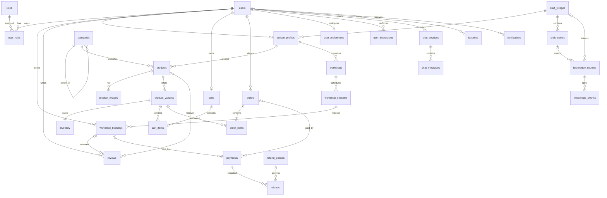

# LocalCraft Database Design Specification

**Project:** LocalCraft — A Platform Connecting Artisans and Tourists Through Local Handicraft Products and Experiences  
**Stack:** MySQL, Django, Django REST Framework, React, Vite, TypeScript  
**Scope:** 30 tables

## 1. Conventions

- Use `snake_case` for table and column names.
- Every table has an explicit primary key such as `user_id`, `product_id`, or `booking_id`.
- `PK` = primary key; `FK` = foreign key; `UQ` = unique; `NN` = not null.
- Use `BIGINT` for primary/foreign keys, `DECIMAL(12,2)` for money, and `DATETIME` for timestamps.
- Store timestamps consistently in UTC in the backend and convert to local time for display.
- Define statuses with Django `TextChoices` and validate business state transitions in service-layer code.
- The schema below is a proposed implementation design and should be checked against final requirements before migrations.

## 2. Table Inventory

| # | Table | Purpose |
|---:|---|---|
| 1 | `users` | Accounts and authentication |
| 2 | `roles` | System roles |
| 3 | `user_roles` | User-role assignments |
| 4 | `artisan_profiles` | Artisan profiles and verification |
| 5 | `craft_villages` | Craft village information and location |
| 6 | `categories` | Hierarchical categories |
| 7 | `craft_stories` | Craft village cultural stories |
| 8 | `products` | Handicraft product information |
| 9 | `product_images` | Product image gallery |
| 10 | `product_variants` | Options such as color and size |
| 11 | `inventory` | Stock for each variant |
| 12 | `workshops` | Artisan-led experiences |
| 13 | `workshop_sessions` | Scheduled workshop sessions |
| 14 | `workshop_bookings` | Workshop reservations |
| 15 | `reviews` | Product and workshop reviews |
| 16 | `carts` | Active shopping carts |
| 17 | `cart_items` | Variants in a cart |
| 18 | `orders` | Product orders and shipping snapshots (parent order) |
| 19 | `vendor_orders` | Child vendor orders partitioned by craft village |
| 20 | `order_items` | Order lines and price snapshots (linked to vendor order) |
| 21 | `payments` | Payments for orders or bookings |
| 22 | `refund_policies` | Refund rules |
| 23 | `refunds` | Refund requests and processing |
| 24 | `user_preferences` | Personalization preferences |
| 25 | `user_interactions` | Activity used by recommendation features |
| 26 | `chat_sessions` | Chatbot sessions |
| 27 | `chat_messages` | Chat messages |
| 28 | `knowledge_sources` | Approved RAG source material |
| 29 | `knowledge_chunks` | Text chunks derived from sources |
| 30 | `favorites` | Saved products/workshops/villages/stories |
| 31 | `notifications` | User notifications |

## 3. Detailed Table Definitions

### 3.1 `users`

| Field | Type | Constraints / meaning |
|---|---|---|
| `user_id` | BIGINT | PK, AUTO_INCREMENT |
| `email` | VARCHAR(255) | NN, UQ; normalize to lowercase |
| `password_hash` | VARCHAR(255) | NN; password hash only |
| `full_name` | VARCHAR(150) | NN |
| `gender` | VARCHAR(10) | Nullable; choices: `MALE`, `FEMALE`, `OTHER` |
| `phone` | VARCHAR(20) | Nullable; unique when provided |
| `avatar_url` | VARCHAR(500) | Nullable |
| `status` | VARCHAR(20) | NN, default `ACTIVE`: `ACTIVE`, `INACTIVE`, `SUSPENDED` |
| `email_verified_at` | DATETIME | Nullable |
| `last_login_at` | DATETIME | Nullable |
| `created_at` | DATETIME | NN |
| `updated_at` | DATETIME | NN |

Do not store a single role on `users`; use `roles` and `user_roles`.

### 3.2 `roles`

| Field | Type | Constraints / meaning |
|---|---|---|
| `role_id` | BIGINT | PK, AUTO_INCREMENT |
| `role_code` | VARCHAR(50) | NN, UQ |
| `role_name` | VARCHAR(100) | NN |
| `description` | TEXT | Nullable |
| `created_at` | DATETIME | NN |

Suggested roles: `TOURIST`, `CRAFT_VILLAGE`, `ADMIN`.
- `TOURIST`: Du khách trải nghiệm làng nghề, đặt sản phẩm & workshop.
- `CRAFT_VILLAGE`: Tài khoản đại diện quản lý 1 làng nghề (1 tài khoản quản lý đúng 1 làng nghề).
- `ADMIN`: Quản trị viên toàn hệ thống.
*(Lưu ý: Nghệ nhân `ARTISAN` là hồ sơ văn hoá thông tin phi đăng nhập, không phải tài khoản người dùng độc lập).*

### 3.3 `user_roles`

| Field | Type | Constraints / meaning |
|---|---|---|
| `user_role_id` | BIGINT | PK, AUTO_INCREMENT |
| `user_id` | BIGINT | FK → `users.user_id`, NN, UQ |
| `role_id` | BIGINT | FK → `roles.role_id`, NN |
| `assigned_at` | DATETIME | NN |

Constraint: `UNIQUE(user_id)` (mỗi người dùng có đúng 1 vai trò chính).

### 3.4 `artisan_profiles`

| Field | Type | Constraints / meaning |
|---|---|---|
| `artisan_id` | BIGINT | PK, AUTO_INCREMENT |
| `village_id` | BIGINT | FK → `craft_villages.village_id`, NN |
| `display_name` | VARCHAR(150) | NN |
| `bio` | TEXT | Nullable |
| `avatar_url` | VARCHAR(500) | Nullable |
| `experience_years` | SMALLINT | Default 0; >= 0 |
| `verification_status` | VARCHAR(20) | NN, default `APPROVED`: `PENDING`, `APPROVED`, `REJECTED` |
| `verification_note` | TEXT | Nullable |
| `created_at` | DATETIME | NN |
| `updated_at` | DATETIME | NN |

Hồ sơ nghệ nhân là thực thể văn hoá thông tin thuộc quản lý của làng nghề (`village_id`), không sở hữu tài khoản đăng nhập `user_id`. Ban quản lý làng nghề tạo và cập nhật hồ sơ nghệ nhân của làng mình.

### 3.5 `craft_villages`

| Field | Type | Constraints / meaning |
|---|---|---|
| `village_id` | BIGINT | PK, AUTO_INCREMENT |
| `manager_user_id` | BIGINT | FK → `users.user_id`, UQ, Nullable (liên kết 1-1 với tài khoản có vai trò `CRAFT_VILLAGE`) |
| `village_name` | VARCHAR(200) | NN |
| `slug` | VARCHAR(220) | NN, UQ |
| `description` | TEXT | Nullable |
| `province` | VARCHAR(100) | NN |
| `district` | VARCHAR(100) | Nullable |
| `address` | VARCHAR(255) | Nullable |
| `latitude` | DECIMAL(10,7) | Nullable; -90 to 90 |
| `longitude` | DECIMAL(10,7) | Nullable; -180 to 180 |
| `cover_image_url` | VARCHAR(500) | Nullable |
| `status` | VARCHAR(20) | NN, default `ACTIVE` |
| `created_at` | DATETIME | NN |
| `updated_at` | DATETIME | NN |

Mỗi tài khoản `CRAFT_VILLAGE` quản lý tối đa 1 làng nghề, và mỗi làng nghề có tối đa 1 tài khoản quản lý đại diện.

A village has many artisan profiles and stories.

### 3.6 `categories`

| Field | Type | Constraints / meaning |
|---|---|---|
| `category_id` | BIGINT | PK, AUTO_INCREMENT |
| `parent_category_id` | BIGINT | Self-FK → `categories.category_id`, nullable |
| `category_name` | VARCHAR(120) | NN |
| `slug` | VARCHAR(150) | NN, UQ |
| `description` | TEXT | Nullable |
| `status` | VARCHAR(20) | NN, default `ACTIVE` |
| `created_at` | DATETIME | NN |

Prevent self-parenting and cyclic category hierarchies in application validation.

### 3.7 `craft_stories`

| Field | Type | Constraints / meaning |
|---|---|---|
| `story_id` | BIGINT | PK, AUTO_INCREMENT |
| `village_id` | BIGINT | FK → `craft_villages.village_id`, NN |
| `artisan_id` | BIGINT | FK → `artisan_profiles.artisan_id`, nullable |
| `title` | VARCHAR(200) | NN |
| `slug` | VARCHAR(220) | NN, UQ |
| `summary` | VARCHAR(500) | Nullable |
| `content` | LONGTEXT | NN |
| `cover_image_url` | VARCHAR(500) | Nullable |
| `status` | VARCHAR(20) | NN, default `DRAFT`: `DRAFT`, `PENDING`, `APPROVED`, `REJECTED`, `HIDDEN` |
| `published_at` | DATETIME | Nullable |
| `created_at` | DATETIME | NN |
| `updated_at` | DATETIME | NN |

Only approved stories should be public or used as chatbot knowledge.

### 3.8 `products`

| Field | Type | Constraints / meaning |
|---|---|---|
| `product_id` | BIGINT | PK, AUTO_INCREMENT |
| `village_id` | BIGINT | FK → `craft_villages.village_id`, NN (Làng nghề sở hữu và quản lý) |
| `artisan_id` | BIGINT | FK → `artisan_profiles.artisan_id`, Nullable (Nghệ nhân sáng tác/chế tác) |
| `category_id` | BIGINT | FK → `categories.category_id`, NN |
| `product_name` | VARCHAR(200) | NN |
| `slug` | VARCHAR(220) | NN, UQ |
| `description` | LONGTEXT | NN |
| `base_price` | DECIMAL(12,2) | NN, >= 0; reference price |
| `cover_image_url` | VARCHAR(500) | Nullable |
| `status` | VARCHAR(20) | NN, default `DRAFT`: `DRAFT`, `PENDING`, `APPROVED`, `REJECTED`, `HIDDEN` |
| `moderation_note` | TEXT | Nullable |
| `published_at` | DATETIME | Nullable |
| `created_at` | DATETIME | NN |
| `updated_at` | DATETIME | NN |

Sản phẩm thuộc sở hữu quản lý của làng nghề (`village_id`). Ghi nhận nghệ nhân sáng tác (`artisan_id`) là thông tin văn hóa tùy chọn.

### 3.9 `product_images`

| Field | Type | Constraints / meaning |
|---|---|---|
| `product_image_id` | BIGINT | PK, AUTO_INCREMENT |
| `product_id` | BIGINT | FK → `products.product_id`, NN |
| `image_url` | VARCHAR(500) | NN |
| `alt_text` | VARCHAR(255) | Nullable |
| `display_order` | SMALLINT | NN, default 0; >= 0 |
| `is_primary` | BOOLEAN | NN, default FALSE |
| `created_at` | DATETIME | NN |

Relationship: `products` 1:N `product_images`. At most one primary image per product; enforce with a supported conditional unique index or transactional application validation.

### 3.10 `product_variants`

| Field | Type | Constraints / meaning |
|---|---|---|
| `variant_id` | BIGINT | PK, AUTO_INCREMENT |
| `product_id` | BIGINT | FK → `products.product_id`, NN |
| `sku` | VARCHAR(100) | NN, UQ |
| `variant_name` | VARCHAR(150) | NN |
| `color` | VARCHAR(80) | Nullable |
| `size` | VARCHAR(80) | Nullable |
| `attributes` | JSON | Nullable; additional options |
| `price` | DECIMAL(12,2) | NN, >= 0 |
| `weight_gram` | INT | Nullable; if present, > 0 |
| `is_active` | BOOLEAN | NN, default TRUE |
| `created_at` | DATETIME | NN |
| `updated_at` | DATETIME | NN |

SKU must be unique. Prevent duplicate normalized attribute combinations within the same product. Inactive variants cannot be purchased.

### 3.11 `inventory`

| Field | Type | Constraints / meaning |
|---|---|---|
| `inventory_id` | BIGINT | PK, AUTO_INCREMENT |
| `variant_id` | BIGINT | FK → `product_variants.variant_id`, NN, UQ |
| `quantity` | INT | NN, default 0; >= 0 |
| `reserved_quantity` | INT | NN, default 0; >= 0 |
| `updated_at` | DATETIME | NN |

Constraint: `reserved_quantity <= quantity`. Sellable stock = `quantity - reserved_quantity`. Use transactions and row locks to prevent overselling; release reservations exactly once.

### 3.12 `workshops`

| Field | Type | Constraints / meaning |
|---|---|---|
| `workshop_id` | BIGINT | PK, AUTO_INCREMENT |
| `village_id` | BIGINT | FK → `craft_villages.village_id`, NN (Làng nghề tổ chức và quản lý) |
| `artisan_id` | BIGINT | FK → `artisan_profiles.artisan_id`, Nullable (Nghệ nhân đứng lớp hướng dẫn) |
| `category_id` | BIGINT | FK → `categories.category_id`, nullable |
| `workshop_name` | VARCHAR(200) | NN |
| `slug` | VARCHAR(220) | NN, UQ |
| `description` | LONGTEXT | NN |
| `duration_minutes` | INT | NN, > 0 |
| `price_per_person` | DECIMAL(12,2) | NN, >= 0 |
| `min_participants` | SMALLINT | NN, default 1; > 0 |
| `location_address` | VARCHAR(255) | NN |
| `cover_image_url` | VARCHAR(500) | Nullable |
| `status` | VARCHAR(20) | NN, default `DRAFT`: `DRAFT`, `PENDING`, `APPROVED`, `REJECTED`, `HIDDEN` |
| `created_at` | DATETIME | NN |
| `updated_at` | DATETIME | NN |

Workshop thuộc sở hữu quản lý của làng nghề (`village_id`). Ghi nhận nghệ nhân hướng dẫn (`artisan_id`) là thông tin tùy chọn.

### 3.13 `workshop_sessions`

| Field | Type | Constraints / meaning |
|---|---|---|
| `session_id` | BIGINT | PK, AUTO_INCREMENT |
| `workshop_id` | BIGINT | FK → `workshops.workshop_id`, NN |
| `start_at` | DATETIME | NN |
| `end_at` | DATETIME | NN |
| `capacity` | SMALLINT | NN, > 0 |
| `booked_participants` | INT | NN, default 0 |
| `price_per_person` | DECIMAL(12,2) | NN, >= 0 |
| `status` | VARCHAR(20) | NN, default `OPEN`: `OPEN`, `FULL`, `CANCELLED`, `COMPLETED` |
| `created_at` | DATETIME | NN |
| `updated_at` | DATETIME | NN |

Constraints: `end_at > start_at`; `0 <= booked_participants <= capacity`. Prevent overlapping sessions where needed. Booking and capacity updates must be one transaction.

### 3.14 `workshop_bookings`

| Field | Type | Constraints / meaning |
|---|---|---|
| `booking_id` | BIGINT | PK, AUTO_INCREMENT |
| `booking_code` | VARCHAR(50) | NN, UQ |
| `user_id` | BIGINT | FK → `users.user_id`, NN |
| `session_id` | BIGINT | FK → `workshop_sessions.session_id`, NN |
| `participant_count` | SMALLINT | NN, > 0 |
| `unit_price` | DECIMAL(12,2) | NN, >= 0; price snapshot |
| `total_amount` | DECIMAL(12,2) | NN, >= 0 |
| `status` | VARCHAR(20) | NN, default `PENDING`: `PENDING`, `CONFIRMED`, `CANCELLED`, `COMPLETED`, `NO_SHOW`, `EXPIRED` |
| `special_request` | TEXT | Nullable |
| `cancelled_at` | DATETIME | Nullable |
| `created_at` | DATETIME | NN |
| `updated_at` | DATETIME | NN |

Rules: `total_amount = participant_count * unit_price`; validate server-side. Never exceed session capacity under concurrent requests. Completed bookings can qualify for workshop reviews.

### 3.15 `reviews`

| Field | Type | Constraints / meaning |
|---|---|---|
| `review_id` | BIGINT | PK, AUTO_INCREMENT |
| `user_id` | BIGINT | FK → `users.user_id`, NN |
| `product_id` | BIGINT | FK → `products.product_id`, nullable |
| `booking_id` | BIGINT | FK → `workshop_bookings.booking_id`, nullable |
| `rating` | TINYINT | NN, 1–5 |
| `title` | VARCHAR(200) | Nullable |
| `content` | TEXT | Nullable |
| `status` | VARCHAR(20) | NN, default `VISIBLE` |
| `created_at` | DATETIME | NN |
| `updated_at` | DATETIME | NN |

Exactly one of `product_id` and `booking_id` must be non-null. A user may review a product once or a workshop booking once. Product reviews require a qualifying purchase; workshop reviews require a completed booking. Enforce cross-table eligibility in backend services.

### 3.16 `carts`

| Field | Type | Constraints / meaning |
|---|---|---|
| `cart_id` | BIGINT | PK, AUTO_INCREMENT |
| `user_id` | BIGINT | FK → `users.user_id`, NN, UQ |
| `created_at` | DATETIME | NN |
| `updated_at` | DATETIME | NN |

One active cart per user. Calculate cart totals from current prices and quantities; do not treat a stored total as authoritative.

### 3.17 `cart_items`

| Field | Type | Constraints / meaning |
|---|---|---|
| `cart_item_id` | BIGINT | PK, AUTO_INCREMENT |
| `cart_id` | BIGINT | FK → `carts.cart_id`, NN |
| `variant_id` | BIGINT | FK → `product_variants.variant_id`, NN |
| `quantity` | INT | NN, > 0 |
| `added_at` | DATETIME | NN |
| `updated_at` | DATETIME | NN |

Constraint: `UNIQUE(cart_id, variant_id)`; update the existing row if the same variant is added again.

### 3.18 `orders`

| Field | Type | Constraints / meaning |
|---|---|---|
| `order_id` | BIGINT | PK, AUTO_INCREMENT |
| `order_code` | VARCHAR(50) | NN, UQ |
| `user_id` | BIGINT | FK → `users.user_id`, NN |
| `subtotal` | DECIMAL(12,2) | NN, >= 0 |
| `shipping_fee` | DECIMAL(12,2) | NN, default 0 |
| `discount_amount` | DECIMAL(12,2) | NN, default 0 |
| `total_amount` | DECIMAL(12,2) | NN, >= 0 |
| `recipient_name` | VARCHAR(150) | NN |
| `recipient_phone` | VARCHAR(20) | NN |
| `shipping_address` | VARCHAR(500) | NN |
| `shipping_note` | VARCHAR(500) | Nullable |
| `status` | VARCHAR(20) | NN, default `PENDING` |
| `payment_status` | VARCHAR(20) | NN, default `UNPAID` |
| `placed_at` | DATETIME | Nullable |
| `created_at` | DATETIME | NN |
| `updated_at` | DATETIME | NN |

Order statuses: `PENDING`, `CONFIRMED`, `PROCESSING`, `SHIPPED`, `DELIVERED`, `CANCELLED`, `COMPLETED`. Payment statuses: `UNPAID`, `PENDING`, `PAID`, `PARTIALLY_REFUNDED`, `REFUNDED`, `FAILED`.

Đơn hàng cha (`orders`) đóng vai trò đơn gom khách hàng (Parent Order). Khi giỏ hàng có sản phẩm từ nhiều làng nghề, hệ thống tự động tách thành các đơn con làng nghề (`vendor_orders`).

### 3.19 `vendor_orders`

| Field | Type | Constraints / meaning |
|---|---|---|
| `vendor_order_id` | BIGINT | PK, AUTO_INCREMENT |
| `vendor_order_code` | VARCHAR(60) | NN, UQ |
| `order_id` | BIGINT | FK → `orders.order_id`, NN |
| `village_id` | BIGINT | FK → `craft_villages.village_id`, NN |
| `subtotal` | DECIMAL(12,2) | NN, >= 0 |
| `shipping_fee` | DECIMAL(12,2) | NN, default 0 |
| `discount_amount` | DECIMAL(12,2) | NN, default 0 |
| `total_amount` | DECIMAL(12,2) | NN, >= 0 |
| `status` | VARCHAR(20) | NN, default `PENDING`: `PENDING`, `CONFIRMED`, `PROCESSING`, `SHIPPED`, `DELIVERED`, `COMPLETED`, `CANCELLED` |
| `payment_status` | VARCHAR(20) | NN, default `UNPAID` |
| `recipient_name` | VARCHAR(150) | NN |
| `recipient_phone` | VARCHAR(20) | NN |
| `shipping_address` | VARCHAR(500) | NN |
| `shipping_note` | VARCHAR(500) | Nullable |
| `tracking_code` | VARCHAR(100) | Nullable |
| `shipped_at` | DATETIME | Nullable |
| `delivered_at` | DATETIME | Nullable |
| `created_at` | DATETIME | NN |
| `updated_at` | DATETIME | NN |

Mỗi đơn hàng con đại diện cho phần đơn hàng do một làng nghề xử lý. Ban quản lý làng nghề chỉ xem và cập nhật đơn hàng con thuộc làng mình. Trạng thái đơn cha được đồng bộ tự động từ các đơn con.

### 3.20 `order_items`

| Field | Type | Constraints / meaning |
|---|---|---|
| `order_item_id` | BIGINT | PK, AUTO_INCREMENT |
| `order_id` | BIGINT | FK → `orders.order_id`, NN |
| `vendor_order_id` | BIGINT | FK → `vendor_orders.vendor_order_id`, NN |
| `variant_id` | BIGINT | FK → `product_variants.variant_id`, NN |
| `product_name_snapshot` | VARCHAR(200) | NN |
| `variant_name_snapshot` | VARCHAR(150) | NN |
| `sku_snapshot` | VARCHAR(100) | NN |
| `unit_price` | DECIMAL(12,2) | NN, >= 0 |
| `quantity` | INT | NN, > 0 |
| `line_total` | DECIMAL(12,2) | NN, >= 0 |
| `created_at` | DATETIME | NN |

Rules: `line_total = unit_price * quantity`. Mỗi mục đơn hàng thuộc đúng 1 đơn hàng con của làng nghề sở hữu sản phẩm đó.

### 3.20 `payments`

| Field | Type | Constraints / meaning |
|---|---|---|
| `payment_id` | BIGINT | PK, AUTO_INCREMENT |
| `payment_code` | VARCHAR(50) | NN, UQ |
| `order_id` | BIGINT | FK → `orders.order_id`, nullable |
| `booking_id` | BIGINT | FK → `workshop_bookings.booking_id`, nullable |
| `payment_method` | VARCHAR(30) | NN |
| `amount` | DECIMAL(12,2) | NN, > 0 |
| `currency` | CHAR(3) | NN, default `VND` |
| `status` | VARCHAR(20) | NN, default `PENDING`: `PENDING`, `SUCCESS`, `FAILED`, `CANCELLED`, `REFUNDED`, `PARTIALLY_REFUNDED` |
| `provider_transaction_id` | VARCHAR(150) | Nullable |
| `idempotency_key` | VARCHAR(100) | Nullable, unique when present |
| `paid_at` | DATETIME | Nullable |
| `created_at` | DATETIME | NN |
| `updated_at` | DATETIME | NN |

Exactly one of `order_id` and `booking_id` must be non-null. Verify provider webhook signatures and process events idempotently. Prevent overpayment. Multiple attempts may reference the same order/booking. For multiple providers, add `provider_code` and a unique constraint on `(provider_code, provider_transaction_id)`.

### 3.21 `refund_policies`

| Field | Type | Constraints / meaning |
|---|---|---|
| `refund_policy_id` | BIGINT | PK, AUTO_INCREMENT |
| `policy_name` | VARCHAR(200) | NN |
| `applies_to` | VARCHAR(20) | NN: `PRODUCT`, `WORKSHOP`, `ALL` |
| `hours_before_start` | INT | Nullable; workshop rule |
| `refund_percentage` | DECIMAL(5,2) | NN, 0–100 |
| `fixed_fee` | DECIMAL(12,2) | NN, default 0 |
| `description` | TEXT | Nullable |
| `effective_from` | DATETIME | NN |
| `effective_to` | DATETIME | Nullable |
| `status` | VARCHAR(20) | NN, default `ACTIVE` |
| `created_at` | DATETIME | NN |
| `updated_at` | DATETIME | NN |

Rules: percentage between 0 and 100; fee >= 0; `effective_to > effective_from` when present. Define policy precedence in backend. Do not silently apply new policies to historical transactions.

### 3.22 `refunds`

| Field | Type | Constraints / meaning |
|---|---|---|
| `refund_id` | BIGINT | PK, AUTO_INCREMENT |
| `refund_code` | VARCHAR(50) | NN, UQ |
| `payment_id` | BIGINT | FK → `payments.payment_id`, NN |
| `refund_policy_id` | BIGINT | FK → `refund_policies.refund_policy_id`, nullable |
| `requested_by` | BIGINT | FK → `users.user_id`, NN |
| `amount_requested` | DECIMAL(12,2) | NN, > 0 |
| `amount_approved` | DECIMAL(12,2) | Nullable |
| `reason` | TEXT | NN |
| `admin_note` | TEXT | Nullable |
| `status` | VARCHAR(20) | NN, default `REQUESTED`: `REQUESTED`, `APPROVED`, `REJECTED`, `PROCESSING`, `COMPLETED`, `FAILED` |
| `requested_at` | DATETIME | NN |
| `processed_at` | DATETIME | Nullable |
| `provider_refund_id` | VARCHAR(150) | Nullable |
| `created_at` | DATETIME | NN |
| `updated_at` | DATETIME | NN |

Refund only successful payments. Approved amounts must be positive and no greater than the remaining refundable amount. Total completed refunds must not exceed successful payment amounts. Handle provider callbacks idempotently and retain history. Consider snapshot fields such as `refund_percentage_snapshot` and `policy_description_snapshot`.

A refund references its payment; the associated order or booking is reached through `payments`.

### 3.23 `user_preferences`

| Field | Type | Constraints / meaning |
|---|---|---|
| `preference_id` | BIGINT | PK, AUTO_INCREMENT |
| `user_id` | BIGINT | FK → `users.user_id`, NN, UQ |
| `preferred_categories` | JSON | Nullable |
| `preferred_activities` | JSON | Nullable |
| `preferred_provinces` | JSON | Nullable |
| `min_budget` | DECIMAL(12,2) | Nullable, >= 0 |
| `max_budget` | DECIMAL(12,2) | Nullable, >= 0 |
| `preferred_language` | VARCHAR(10) | NN, default `vi` |
| `updated_at` | DATETIME | NN |

If both budgets exist, `min_budget <= max_budget`. One user has at most one aggregate preference record. JSON is suitable for flexible multi-select values; normalize frequently queried data if needed.

### 3.24 `user_interactions`

| Field | Type | Constraints / meaning |
|---|---|---|
| `interaction_id` | BIGINT | PK, AUTO_INCREMENT |
| `user_id` | BIGINT | FK → `users.user_id`, nullable for anonymous users |
| `target_type` | VARCHAR(20) | NN: `PRODUCT`, `WORKSHOP`, `VILLAGE`, `STORY` |
| `target_id` | BIGINT | NN; target object ID |
| `action_type` | VARCHAR(30) | NN: `VIEW`, `SEARCH`, `CLICK`, `FAVORITE`, `ADD_TO_CART`, `BOOKING`, `PURCHASE` |
| `metadata` | JSON | Nullable |
| `session_key` | VARCHAR(100) | Nullable |
| `created_at` | DATETIME | NN |

`target_id` is polymorphic and cannot be a conventional FK to multiple tables. Validate type and target existence in the backend. Avoid sensitive personal data in metadata and define data-retention rules.

### 3.25 `chat_sessions`

| Field | Type | Constraints / meaning |
|---|---|---|
| `chat_session_id` | BIGINT | PK, AUTO_INCREMENT |
| `user_id` | BIGINT | FK → `users.user_id`, nullable |
| `session_title` | VARCHAR(200) | Nullable |
| `session_key` | VARCHAR(100) | Nullable |
| `status` | VARCHAR(20) | NN, default `ACTIVE`: `ACTIVE`, `CLOSED` |
| `created_at` | DATETIME | NN |
| `updated_at` | DATETIME | NN |

For anonymous visitors, use a random, hard-to-guess session key. Do not use a session key as user authentication.

### 3.26 `chat_messages`

| Field | Type | Constraints / meaning |
|---|---|---|
| `chat_message_id` | BIGINT | PK, AUTO_INCREMENT |
| `chat_session_id` | BIGINT | FK → `chat_sessions.chat_session_id`, NN |
| `sender_type` | VARCHAR(20) | NN: `USER`, `ASSISTANT`, `SYSTEM` |
| `message_content` | LONGTEXT | NN |
| `metadata` | JSON | Nullable |
| `created_at` | DATETIME | NN |

Only the session owner or authorized system component may access messages. Never store API keys or credentials in message content or metadata.

### 3.27 `knowledge_sources`

| Field | Type | Constraints / meaning |
|---|---|---|
| `knowledge_source_id` | BIGINT | PK, AUTO_INCREMENT |
| `source_title` | VARCHAR(250) | NN |
| `source_type` | VARCHAR(30) | NN |
| `source_url` | VARCHAR(500) | Nullable |
| `source_content` | LONGTEXT | Nullable |
| `related_village_id` | BIGINT | FK → `craft_villages.village_id`, nullable |
| `related_story_id` | BIGINT | FK → `craft_stories.story_id`, nullable |
| `status` | VARCHAR(20) | NN, default `PENDING`: `PENDING`, `APPROVED`, `REJECTED`, `ARCHIVED` |
| `approved_by` | BIGINT | FK → `users.user_id`, nullable |
| `approved_at` | DATETIME | Nullable |
| `created_at` | DATETIME | NN |
| `updated_at` | DATETIME | NN |

Only approved sources should be retrieved. Refresh or invalidate chunks/embeddings when source content changes. Current prices, session capacity, and booking availability must come from live business APIs, not RAG text.

### 3.28 `knowledge_chunks`

| Field | Type | Constraints / meaning |
|---|---|---|
| `knowledge_chunk_id` | BIGINT | PK, AUTO_INCREMENT |
| `knowledge_source_id` | BIGINT | FK → `knowledge_sources.knowledge_source_id`, NN |
| `chunk_index` | INT | NN, >= 0 |
| `chunk_content` | LONGTEXT | NN |
| `embedding_ref` | VARCHAR(255) | Nullable |
| `token_count` | INT | Nullable, >= 0 |
| `content_hash` | CHAR(64) | Nullable |
| `created_at` | DATETIME | NN |
| `updated_at` | DATETIME | NN |

Constraint: `UNIQUE(knowledge_source_id, chunk_index)`. Do not retrieve chunks from unapproved or withdrawn sources. `embedding_ref` may reference an external vector store; vectors do not need to be stored directly in MySQL if a vector database is used.

### 3.29 `favorites`

| Field | Type | Constraints / meaning |
|---|---|---|
| `favorite_id` | BIGINT | PK, AUTO_INCREMENT |
| `user_id` | BIGINT | FK → `users.user_id`, NN |
| `target_type` | VARCHAR(20) | NN: `PRODUCT`, `WORKSHOP`, `VILLAGE`, `STORY` |
| `target_id` | BIGINT | NN; target object ID |
| `created_at` | DATETIME | NN |

Constraint: `UNIQUE(user_id, target_type, target_id)`. Validate target type and existence in backend. Delete the row when a favorite is removed, or use soft deletion if history is needed.

### 3.30 `notifications`

| Field | Type | Constraints / meaning |
|---|---|---|
| `notification_id` | BIGINT | PK, AUTO_INCREMENT |
| `user_id` | BIGINT | FK → `users.user_id`, NN |
| `notification_type` | VARCHAR(50) | NN |
| `title` | VARCHAR(200) | NN |
| `message` | TEXT | NN |
| `target_type` | VARCHAR(30) | Nullable |
| `target_id` | BIGINT | Nullable; target object ID |
| `is_read` | BOOLEAN | NN, default FALSE |
| `read_at` | DATETIME | Nullable |
| `created_at` | DATETIME | NN |

Only the owner may read or mark their notifications. If `is_read = TRUE`, `read_at` should be set; otherwise it should be NULL. Validate polymorphic targets in backend.

---

## 4. Main Entity Relationships

| Relationship | Cardinality | Description |
|---|---|---|
| `users` – `roles` | N:N | Through `user_roles` |
| `users` – `artisan_profiles` | 1:0..1 | An account may not have an artisan profile |
| `craft_villages` – `artisan_profiles` | 1:N | One village can have many artisans |
| `craft_villages` – `craft_stories` | 1:N | A village can have many stories |
| `categories` – `products` | 1:N | One category can classify many products |
| `products` – `product_variants` | 1:N | One product can have multiple variants |
| `product_variants` – `inventory` | 1:1 | Each variant has one inventory record |
| `products` – `product_images` | 1:N | One product has multiple images |
| `workshops` – `workshop_sessions` | 1:N | One workshop has multiple sessions |
| `workshop_sessions` – `workshop_bookings` | 1:N | A session can receive multiple bookings |
| `users` – `orders` | 1:N | A user can place multiple orders |
| `orders` – `order_items` | 1:N | An order contains multiple line items |
| `users` – `carts` | 1:0..1 | One active cart per user |
| `carts` – `cart_items` | 1:N | A cart contains multiple variants |
| `orders` – `payments` | 1:N | Multiple payment attempts may exist |
| `workshop_bookings` – `payments` | 1:N | Multiple payment attempts may exist |
| `payments` – `refunds` | 1:N | One payment may have multiple refund requests |
| `refund_policies` – `refunds` | 1:N | A policy may apply to multiple refunds |
| `chat_sessions` – `chat_messages` | 1:N | A session contains multiple messages |
| `knowledge_sources` – `knowledge_chunks` | 1:N | A source is split into chunks |

### Mermaid ER diagram

`target_id` in `favorites`, `user_interactions`, and `notifications` is polymorphic and cannot be a conventional FK to multiple tables.

## 5. Cross-Table Business Constraints

- **Authorization and moderation:** Only verified artisans may publish products/workshops. Unapproved content must not be public or included in RAG.
- **Inventory and booking capacity:** Use transactions and row locks (e.g. Django `select_for_update()`) to prevent overselling or overbooking.
- **Payments and refunds:** Verify payment webhooks, process idempotently, and ensure successful refunds never exceed successful payments. Preserve transaction history.
- **Reviews and AI:** Only eligible users may review products or completed workshop bookings. Filter hard constraints (approval, budget, session schedule, availability) before ranking recommendations.
- **Price snapshots:** Store product name, SKU, price, and shipping address snapshots in orders; store booking price at booking time; retain the refund policy used when a refund is processed.

## 6. Suggested Indexes

| Table | Suggested indexes |
|---|---|
| `users` | Unique `email`; index `status` |
| `artisan_profiles` | Unique `user_id`; indexes `village_id`, `verification_status` |
| `products` | Indexes `artisan_id`, `category_id`, `status`, `published_at` |
| `product_variants` | Index `product_id`; unique `sku` |
| `workshop_sessions` | Composite `(workshop_id, start_at)`; index `status` |
| `workshop_bookings` | Composite `(user_id, created_at)`, `(session_id, status)` |
| `orders` | Composite `(user_id, created_at)`; unique `order_code`; index `status` |
| `payments` | Indexes `(order_id, status)` and `(booking_id, status)` |
| `refunds` | Indexes `(payment_id, status)` and `(requested_by, requested_at)` |
| `user_interactions` | Indexes `(user_id, created_at)`, `(target_type, target_id)` |
| `chat_messages` | Composite `(chat_session_id, created_at)` |
| `knowledge_chunks` | Composite `(knowledge_source_id, chunk_index)` |
| `notifications` | Composite `(user_id, is_read, created_at)` |

## 7. Deletion and Data Retention

- Do not hard-delete orders, payments, processed refunds, or transaction-related reviews.
- Deactivate accounts/artisan profiles with transaction history rather than deleting them outright.
- Cart items may be deleted when a cart is deleted.
- When a knowledge source is withdrawn, remove or disable its chunks/embeddings from retrieval.
- Define retention and deletion policies for interaction history and chat messages.

## 8. Django and MySQL Implementation Notes

1. Use explicit primary key fields and explicit `db_column` names where necessary.
2. Define enums with Django `TextChoices`; validate state transitions in services.
3. Use `transaction.atomic()` and row locking for inventory reservation, booking capacity, order placement, and refunds.
4. Define unique constraints and indexes in Django `Meta.constraints` and `Meta.indexes`.
5. Validate polymorphic relationships (`target_type`/`target_id`) in service-layer code.
6. If the schema differs from Django's default user model, use a custom user model from the beginning. Avoid switching user models after migrations and production data exist.
7. Treat webhook callbacks as untrusted input; verify signatures and use idempotency keys.
8. RAG must not be the authoritative source for current prices, inventory, session capacity, payment status, or booking status.

## 9. Summary

The agreed LocalCraft design contains **30 tables** covering accounts and roles, artisans and villages, multi-variant products and inventory, workshop scheduling and bookings, reviews, shopping carts and orders, payments and refunds, user personalization, chatbot RAG, favorites, and notifications.

This is a practical starting point for the graduation thesis. Confirm provider-specific payment fields, moderation workflow, and AI event logging requirements before creating final migrations.
